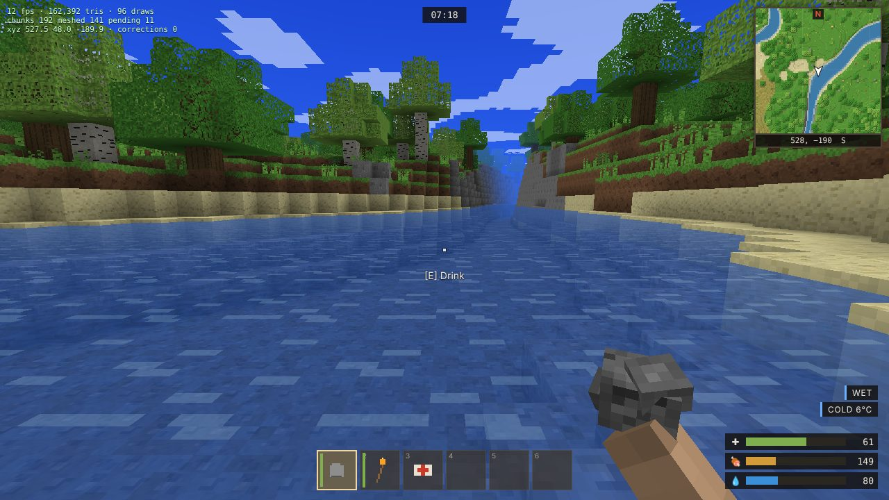
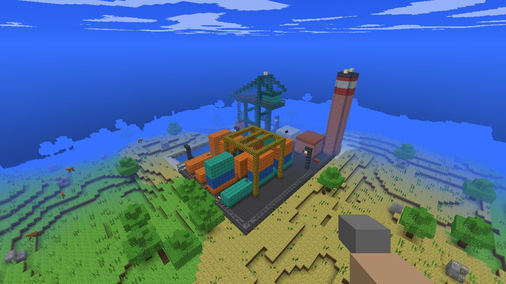
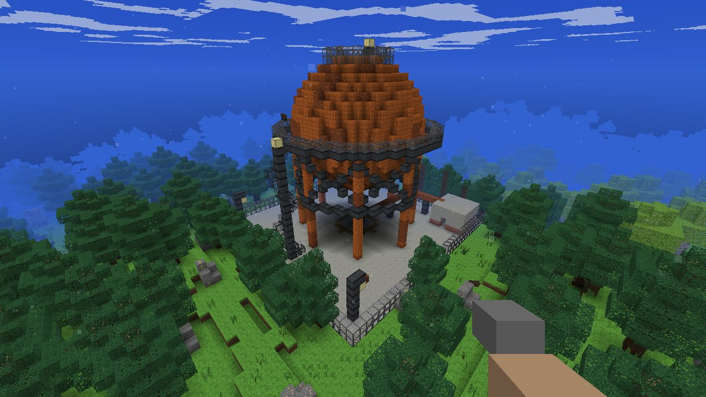
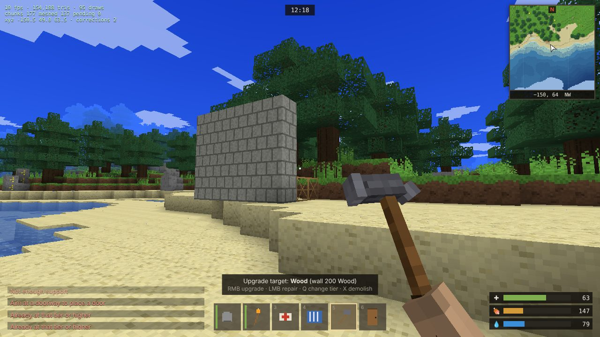
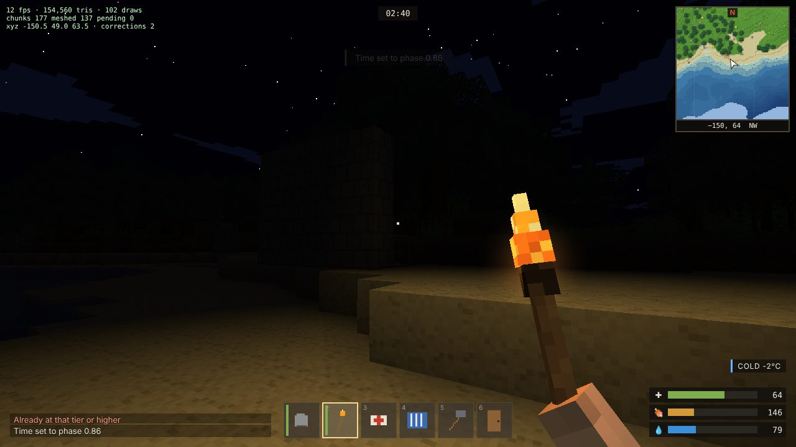
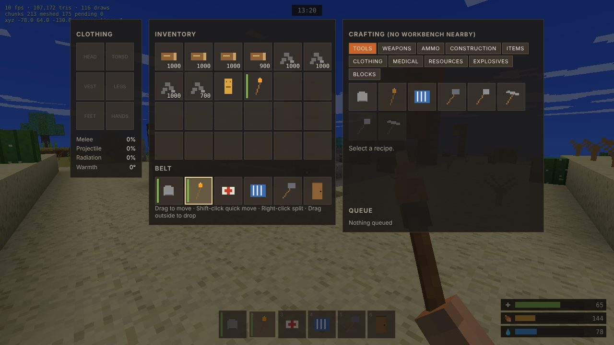
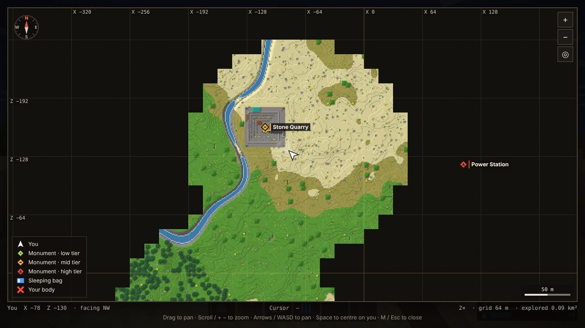

# CORRODE

A **singleplayer voxel survival sandbox**: a Minecraft-style block world you can freely dig and build in,
with Rust-style hardcore survival — hunger, thirst, cold, bleeding and radiation, tiered base building with
stability, upkeep and decay, explosive raiding, firearms with real projectiles, wildlife, armed scavengers
guarding monuments, and death that leaves your gear in your body.

It runs entirely in the browser (WebGL2). The authoritative game simulation runs in a Web Worker as an
integrated server and saves your worlds to IndexedDB with atomic saves.



| | |
|---|---|
|  |  |
|  |  |
|  |  |

## Play

```bash
npm install
npm run dev          # build + serve, then open http://localhost:8080
```
Create a world (optionally with a seed and cheats), then press **F1** in game for the controls and survival
guide. Basics: WASD/Space/Shift/Ctrl move, LMB use/attack, RMB secondary, **E** interact/drink, **Tab**
inventory & crafting, **M** map, **R** reload, **Enter** console (`/help`).

## Develop

```bash
npm test             # 255 unit/integration tests (Vitest)
npm run e2e          # headless-browser smoke test incl. save/reload (Playwright + Chromium)
npm run bench        # world gen, meshing, simulation and save benchmarks
npm run typecheck
```

## Documentation
* [docs/RESEARCH.md](docs/RESEARCH.md) — cited Minecraft & Rust research and how it maps to the design
* [docs/DESIGN.md](docs/DESIGN.md) — game design specification
* [docs/ARCHITECTURE.md](docs/ARCHITECTURE.md) — engine choice, simulation model, voxel engine, persistence, testing
* [docs/ROADMAP.md](docs/ROADMAP.md) — feature dependency map and milestones
* [docs/VERIFICATION.md](docs/VERIFICATION.md) — what was tested, results, known gaps and risks
* [docs/DEVLOG.md](docs/DEVLOG.md) — development log

All art (textures, models, icons) and audio are generated procedurally in code. Multiplayer is deferred;
the simulation is structured so a network transport can be added later.
