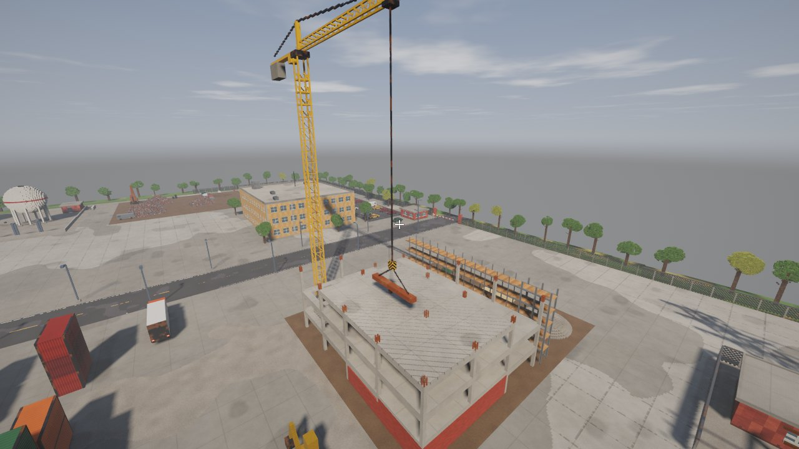
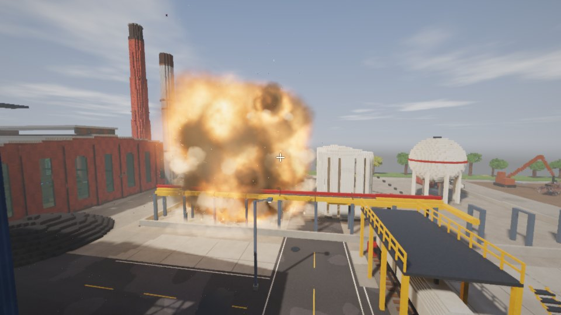
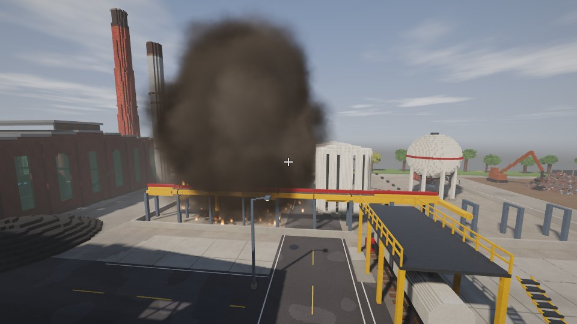

# Voxel Teardown

A Teardown-style destruction sandbox that runs in the browser (WebGL2). One large industrial
factory site, built from 10 cm voxels, where everything is destructible and simulated: walls,
floors, roofs, steel frames, tanks, machines, vehicles, fences and the ground itself.



| Fuel tank chain reaction | Five seconds later |
| --- | --- |
|  |  |
| **Sunset over the tank farm** | **Night on the main avenue** |
|  |  |

## Running

```sh
npm install
npm run dev      # builds, watches and serves on http://localhost:8080
# or
npm run build    # writes dist/ (open dist/index.html through any static web server)
```

A prebuilt `dist/` is committed, so serving that folder is enough (`npx serve dist`, `python3 -m http.server -d dist`).

Click the menu to start (the mouse is captured; Esc brings the menu back). URL options: `?quality=auto|low|medium|high|ultra` (default `auto`), `?env=afternoon|sunset|overcast|night`,
`?testmap` (small test level), `?autoplay` (skip the menu), `?stats` (performance overlay).

### Controls

| Key | Action | Key | Action |
| --- | --- | --- | --- |
| W A S D | Move | Mouse | Look |
| Shift | Sprint | Space | Jump |
| C / Ctrl | Crouch | LMB | Use tool |
| 1 – 8 / wheel | Select tool | E | Grab / drop object |
| F | Flashlight | V | Fly (noclip) |
| T | Time of day | R | Slow motion |
| Esc | Menu / settings | F3 | Stats overlay |

Tools: sledgehammer, shotgun, rifle, pipe bomb, bomb, rocket launcher, blowtorch, grab.

## The map

A 256 m × 256 m × 64 m site (2560 × 640 × 2560 voxels, ~100 M voxels of structure): a steel-framed
production hall with travelling crane, presses, CNC machines, robot cells and conveyors; a high-bay
warehouse with racking and loading docks; a three-storey office block; a boiler house with a brick
chimney and steel stack; a fuel tank farm with pipe racks and a gas sphere; grain silos; a water tower;
an electrical substation with transformers and pylons; a container yard; a rail siding with wagons;
a concrete skeleton under construction with scaffolding and a tower crane; a scrap yard; roads,
parking, fences, street lights, power lines, trees and terrain (earth, gravel, coal and sand heaps).
Hundreds of props (cars, trucks, forklifts, barrels, gas bottles, pallets, crates, IBC tanks…) are
free rigid bodies.

## How it works

**World.** 16³ chunks (empty / uniform / dense, plus *virtual terrain* chunks evaluated on demand from
a heightmap and per-column ground layers, so the ground costs no memory until it is dug into). A
255-entry palette maps every voxel to a material (density, hardness, blast resistance, friction,
flammability…) and a colour with a procedural surface pattern (bricks, planks, corrugation, concrete…).

**Rendering** (`src/render`). 32³ render regions are greedy-meshed with per-corner ambient occlusion in
a worker pool; quads (16 bytes each) live in one big integer texture and are drawn with vertex pulling
and multi-draw. Distant regions are meshed from 2× / 4× downsampled voxels (LOD). Deferred pipeline:
4-cascade shadow maps, G-buffer, SSAO, directional sky-occlusion maps (dark interiors, light through
openings), ray-marched volumetric sun light, screen-space reflections on glossy surfaces and puddles,
point lights (lamps, street lights, fire, explosions), analytic sky and height fog, glass, lit
particles with soft depth fade, TAA, bloom and ACES tone mapping. Four lighting presets (afternoon,
sunset, overcast, night).

**Physics** (`src/physics`). Every body is a voxel grid. Collisions are sphere samples on the surface
voxels against exposed voxel faces of the world and of other bodies, reduced to stable manifolds and
solved with a warm-started sequential impulse solver (friction, restitution, speculative contacts),
with island sleeping and CCD for fast small bodies.

**Structural integrity** (`src/world/structure.ts`, `src/world/stress.ts`). After damage, a
time-sliced best-first flood fill finds parts no longer connected to the ground and turns them into
rigid bodies. A stress solver coarsens the structure into 0.4 m cells, routes every cell's weight to the
ground along the cheapest load paths and compares link loads with per-material compression / shear /
tension capacities, plus a bending check (load × lever arm against a capacity that grows with member
depth, so deep trusses and slabs span far while slender rails and purlins cannot carry a lost column).
Intact structures are analysed once at load time and anything already overloaded is reinforced, so the
level always stands until it is damaged. Cladding, roof sheeting, plaster partitions and suspended ceilings
carry no load (their weight goes to the structure they hang on), and a link may only fail when the damage
made its load path to the ground substantially longer than in the intact structure: cutting columns brings
the floors above down, while a hole in a wall that loads can walk around stays a local event. Overloaded
links crumble, pieces detach, fall and hit things, and the analysis runs again — collapses progress over
seconds instead of being scripted.

**Destruction** (`src/game/destruction.ts`, `fire.ts`). Explosions carve by per-material blast
resistance, throw fragments out as rigid bodies, push bodies with a shockwave, shatter connected glass,
bend sheet metal around the hole (panels bulge away from the blast as connected stepped columns),
blacken the crater with soot, ignite flammables, and set off connected explosive material (fuel tanks,
gas bottles, transformer oil, vehicle fuel tanks) as rolling chain reactions; liquid fuels splash
burning fuel around. Impacts break voxels by kinetic energy vs. material toughness: concrete crumbles
to dust and rubble, metal dents and sparks, wood splinters, glass shatters into thin shards. Fire
spreads through flammable voxels, chars and burns them away, and cooks off explosives. Debris particles
and resting fragments settle into the world as rubble, so damage persists.

## Performance

- Level of detail: regions beyond 60 m / 130 m are meshed from 2× / 4× downsampled voxels (~70% fewer
  quads, no visible change since a voxel is sub-pixel there); frustum culling per region and body.
- Meshing, which re-runs for every modified region, happens in a worker pool off the main thread.
- Physics: island sleeping, per-body world collision caches patched per modified chunk, small
  fragments do not collide with each other and are baked into the static world once they rest.
- Structural analysis and connectivity searches are time-sliced (they resume on the next frame; the stress
  solver also uses whatever CPU time is left at the end of a frame) and cache per-chunk cell masses and
  link capacities, so a long collapse never stalls a frame.
- Chain reactions fire at most two blasts per step and share fragment and particle budgets; glass shattering
  skips chunks without glass; the simulation drops into brief slow motion rather than piling catch-up steps
  onto an expensive frame.
- Moving bodies keep their copy of the surrounding world extended in their direction of travel, and big
  damaged bodies split into pieces from per-piece bounding boxes.
- Dynamic resolution: when the GPU cannot hold 60 fps the render resolution drops in steps (down to
  half) and comes back once there is headroom; frames that are slow because of the CPU leave it alone.
  In `auto` quality (the default) it also steps the preset down (high → medium → low) when even half
  resolution is too slow, and remembers what it settled on for the next launch.
- The 3D image is rendered at CSS-pixel resolution (Ultra uses the full device pixel ratio) and upscaled
  with TAA, so high-DPI laptops do not shade four times the pixels.
- Culling works on 12.8 m superblocks of render regions (one test accepts or rejects 64 regions), the
  opaque pass draws nearest blocks first so hidden surfaces fail the depth test before shading, and
  only point lights whose radius reaches into the view are shaded (up to 12 / 20 / 32 / 48 per preset).
- Resting bodies keep their transforms on the GPU instead of being re-uploaded every frame.
- Quality presets (menu or `?quality=`) scale resolution, shadow map size, SSAO, volumetrics,
  reflections, light count and LOD distances.

## Development

```sh
npm run typecheck
npm test                                         # fast headless tests (resolution control, physics, bending, vehicles)
npm run test:slow                                # structural analysis + collapse on the full map
node tools/runtest.mjs tests/physics.test.ts     # rigid body regression tests (headless)
node tools/runtest.mjs tests/stress.test.ts      # structural analysis on the real map
node tools/runtest.mjs tests/collapse.test.ts    # progressive collapse of the construction site
node tools/runtest.mjs tests/bend.test.ts        # blast-bent sheet metal stays attached
node tools/runtest.mjs tests/vehicle.test.ts     # vehicle fuel tanks: bumps vs. bombs
node tools/scenario.mjs out tests/scenarios/factory_views.json 960 540   # headless screenshots
```

Profiling scripts (`tests/*.prof.ts`) measure LOD quad counts, the construction-site and hall
collapses, the tank-farm chain reaction step by step, and how far cracks spread after a pipe bomb
against each building (`smallblast.prof.ts`).
