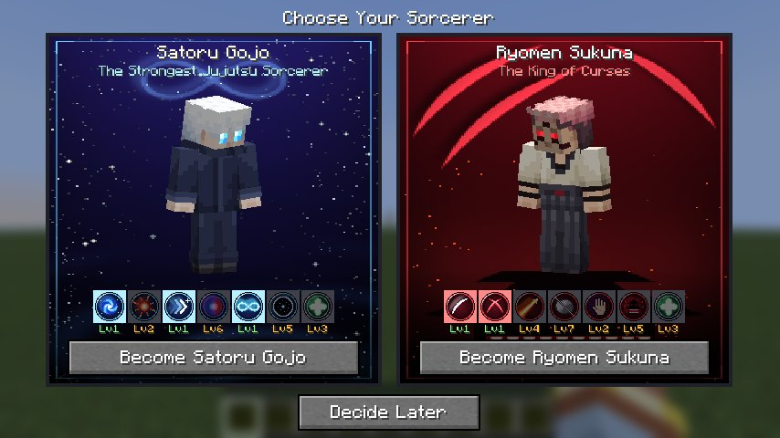
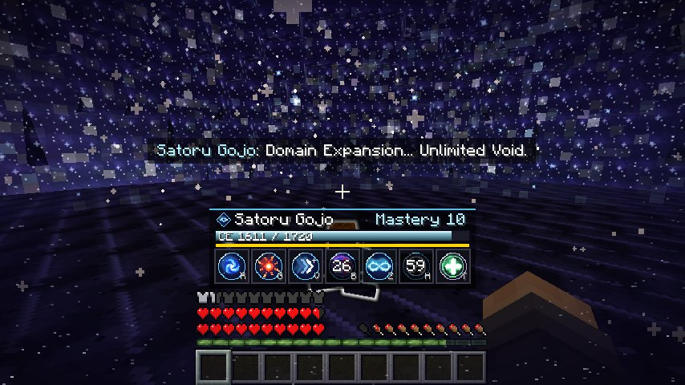
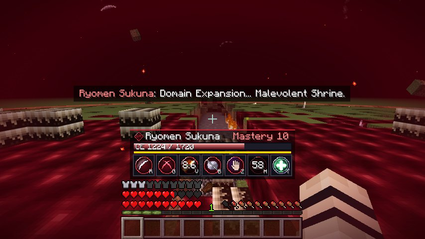
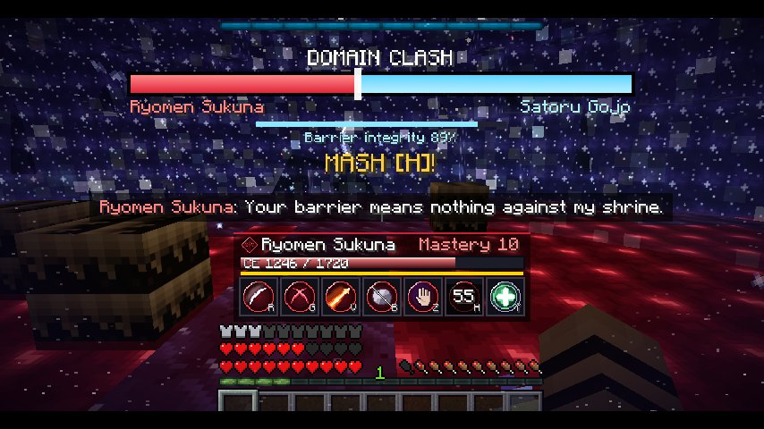
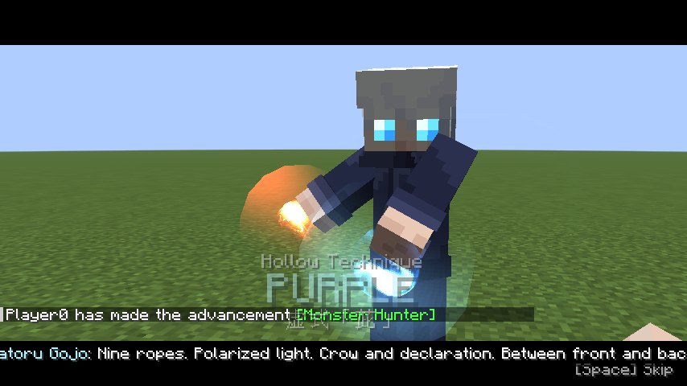
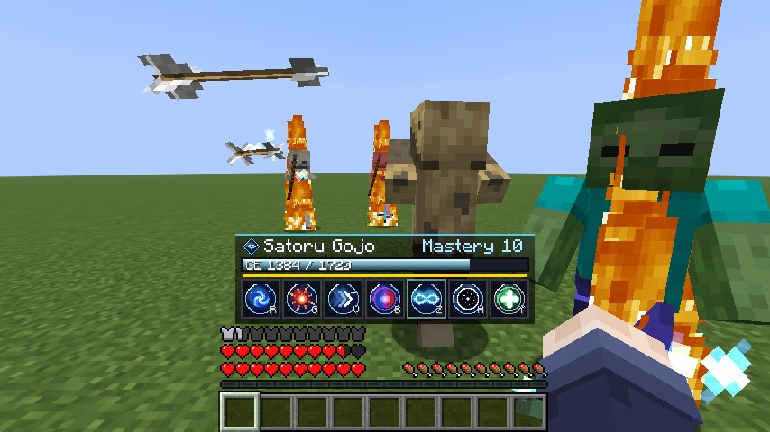
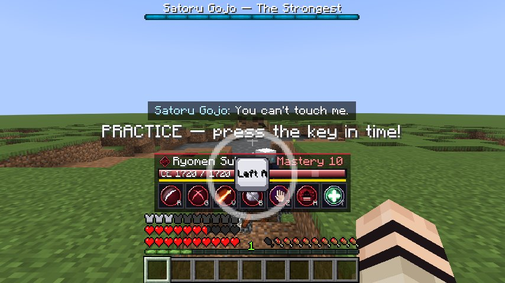
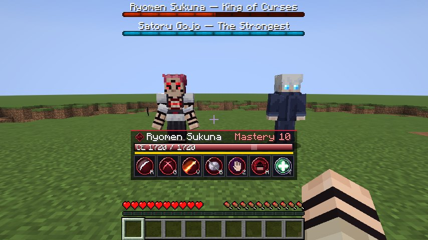

# Jujutsu Showdown: Gojo vs. Sukuna

A cinematic Jujutsu Kaisen combat mod for **Minecraft Java Edition 1.21.11** on **Fabric Loader 0.19.2+**.
Play as **Satoru Gojo** or **Ryomen Sukuna**, master their techniques, expand domains, clash with rival
sorcerers and fight AI versions of each other.

> **Version note:** the request asked for "Minecraft 1.12.11", which does not exist. Fabric Loader 0.19.2 is
> contemporary with **Minecraft 1.21.11** (released December 2025), so the mod targets 1.21.11.


| | |
|---|---|
|  |  |
| *Character selection with live models* | *Inside Unlimited Void* |
|  |  |
| *Malevolent Shrine* | *Player vs. rival domain clash* |
|  |  |
| *Hollow Purple cinematic* | *Infinity holding skeleton arrows mid-air* |
|  |  |
| *Quick-time event* | *Rival Gojo and Heian-era Sukuna* |

*(Screenshots from the automated client test: software rendering, 854×480.)*

---

## Installation (players)

1. Install **Java 21** (Minecraft 1.21.11 ships with it via the official launcher).
2. Install **Fabric Loader 0.19.2** (or newer) for Minecraft **1.21.11** using the
   [Fabric installer](https://fabricmc.net/use/installer/).
3. Download **Fabric API `0.141.6+1.21.11`** (or newer for 1.21.11) and put it in `.minecraft/mods/`.
4. Put `jjk-showdown-1.0.0.jar` in `.minecraft/mods/`.
5. Launch the *fabric-loader-1.21.11* profile. On first join you are offered the character selection
   screen (also available any time with **J**).

The mod is required on **both** the client and the server (it adds entities, blocks and packets).

## Building from source

Requirements: JDK 21 (the Gradle wrapper downloads Gradle 9.8.2 itself).

```bash
./gradlew build
```

The mod jar is written to `build/libs/jjk-showdown-1.0.0.jar` (the `-sources` jar is not needed to play).

Development commands:

```bash
./gradlew runClient          # dev client
./gradlew runServer          # dev dedicated server
./gradlew runGameTest        # automated server-side gameplay tests
xvfb-run ./gradlew runClientGameTest   # scripted client playthrough with screenshots (headless)
```

Assets are reproducible: `python3 tools/gen_data.py` (models, sounds.json, damage types, recipes),
`python3 tools/gen_lang.py` (language file + key check) and the generators in `tools/assetgen/`
(textures, sound effects, music and voice lines).

---

## Controls (rebindable in *Options → Controls → Jujutsu Showdown*)

| Key | Gojo | Sukuna |
|---|---|---|
| **R** (tap / hold) | Lapse: Blue (sneak = Blue movement) | Dismantle (hold = barrage) |
| **G** (tap / hold) | Reversal: Red | Cleave (hold = wide cleave) |
| **V** | Blink (aim at an enemy to appear behind them) | Fuga (hold ≥ 1 s to draw) |
| **B** (hold) | Hollow Purple (keep holding at mastery 9 for 200%) | World-Cutting Slash (full incantation) |
| **Z** | Infinity on/off | Domain Amplification on/off |
| **H** | Unlimited Void (mash during a clash) | Malevolent Shrine (mash during a clash) |
| **Y** (hold) | Reverse Cursed Technique | Reverse Cursed Technique |
| **Left Alt** | Dodge (Gojo blinks) · in air: air dash · in air looking down: slam | Dodge (dash) · air dash · slam |
| **C** (hold) | Guard — start it just before a hit to **parry** | same |
| **Space** in the air | Double jump (2) · keep holding while falling: hover | Double jump (1) |
| **Space** during a cinematic | Skip | Skip |
| **J** / **K** | Character selection / settings | |

*C* also appears as "Save Toolbar Activator" in vanilla; holding it alone does nothing in vanilla, so the shared
default is harmless (rebind if you prefer).

---

## Techniques

Every technique costs cursed energy (CE), has a cooldown, its own animation, sound, voice line and visual effects.
With **progression** on (default) techniques unlock as your **mastery** (1–10) rises; creative mode unlocks
everything. Mastery XP comes from damage, kills, Black Flashes, parries, perfect dodges, clashes and rival kills.

### Satoru Gojo — The Strongest
| Technique | Unlock | Notes |
|---|---|---|
| Infinity | 1 | Projectiles stop mid-air, melee never lands. Small upkeep. Pierced by Domain Amplification, domain sure-hits and the World-Cutting Slash. |
| Lapse: Blue | 1 | Singularity at the crosshair; pulls enemies, projectiles and terrain (blocks orbit and crush). Charge for more. Sneak-cast = Blue movement. |
| Blink | 1 | Instant movement; behind the target if aimed at one. |
| Reversal: Red | 2 | Repulsion orb → huge blast, crater, launch. Point-blank = instant detonation. |
| Reverse Cursed Technique | 3 | Heal; also recovers from domain burnout 3× faster. |
| Unlimited Void | 5 | Barrier dome + void floor. Everyone inside is paralysed by infinite information; your attacks on them deal +50%. |
| Hollow Purple | 6 | Converges Blue and Red, then erases a tunnel through everything. 200% output with the full incantation at mastery 9. |
| *Six Eyes (passive)* | – | Techniques cost ~40–55% less; hostile creatures and players glow through walls. |

### Ryomen Sukuna — King of Curses
| Technique | Unlock | Notes |
|---|---|---|
| Dismantle | 1 | Razor slash cutting enemies and soft terrain. Hold for a barrage at mastery 3. |
| Cleave | 1 | Adapts to the target's toughness (armour, health) — a multi-hit flurry. Charge to cleave a cone. |
| Domain Amplification | 2 | Your blows pass through Infinity and domain sure-hits are blunted, but the innate technique is unusable while active. |
| Reverse Cursed Technique | 3 | Heal and repair burnout. |
| Fuga | 4 | Flaming arrow → inferno. Empowered (bigger, half cost/cooldown) for 10 s after Malevolent Shrine. |
| Malevolent Shrine | 5 | Open domain without a barrier: an enormous radius where everything is ceaselessly Dismantled and Cleaved and terrain is shredded. The shrine itself rises behind you. |
| World-Cutting Slash | 7 | Three-second incantation, then a single plane that cuts the world — ignores Infinity, armour and toughness. |
| *Fingers (passive)* | – | Each of the 20 Sukuna fingers consumed: +2.5% power, +3% CE. |

---

## Combat system

* **Combos** – four-step melee strings (damage ramps up); the 4th hit launches grounded targets or spikes airborne ones.
  The HUD counts hits and shows the combo window.
* **Black Flash** – after each hit a short timing window opens (white ring closing on the crosshair, red when open).
  Strike inside it for a high chance of a Black Flash: 2.5× damage, black-red lightning, inverted-colour flash,
  and *the zone* (more damage, Black Flash chance and CE regen). Chains increase the odds.
* **Dodge** – i-frames; dodging just before a hit is a **perfect dodge** (slow-mo, counter ready).
* **Guard / Parry** – guard reduces damage at a CE cost (guard break when empty). Guard within the parry window to
  **parry**: no damage, attacker staggered, **counter** ready (next blow 1.75×).
* **Air combat** – double jumps, air dash, hover (Gojo), plunging slam with shockwave, juggling (hits keep
  airborne targets afloat).
* **Charged attacks** – Blue, Red, Dismantle barrage, Cleave, Fuga, Hollow Purple, World Slash.
* **Finishers** – a combo finisher/counter/Black Flash on a weakened enemy triggers a finishing move (cinematic for
  sturdy foes; a timing QTE against rival bosses).
* **Destruction** – Blue, Red, Hollow Purple, Dismantle, Fuga, slams and Malevolent Shrine break terrain, with flying
  debris. By default **everything is restored** after a delay (configurable), domain arenas always are.
  Block entities (chests etc.), unbreakable blocks and protected spawn areas are never touched.

## Domain Expansions & clashes

* Activation plays a cinematic (hand sign, camera work, title card in English and Japanese) while the arena forms
  outward from the caster.
* **Consequences** – after a domain ends your innate technique **burns out** (no Infinity!) until it recovers; RCT
  speeds this up. Sustaining a domain drains CE.
* **Counterplay** – expanding your own domain is the one action possible inside Unlimited Void; Domain Amplification
  turns the paralysis into pulses; Malevolent Shrine has no barrier, so you can try to leave its radius.
* **Clash** – when domains overlap they fight for control: a tug-of-war meter driven by each domain's refinement
  (CE, mastery, settings) and the casters' focus (**mash the domain key**). **Gojo vs. Sukuna:** the Shrine erodes
  Unlimited Void's barrier from outside — red cuts appear on the dome; if its integrity hits zero the Void shatters.
  The loser's domain collapses, they take backlash damage, are staggered and burn out longer; the winner's domain
  continues with bonus time.

## Rival bosses

Summon with `/jjk duel gojo|sukuna`, spawn eggs, or items: as Gojo hold up **Sukuna's Finger**; as Sukuna use
**Gojo's Blindfold**. Rivals use the same technique system as players: Gojo keeps Infinity up, controls space with
Blue/Red, blinks behind you and fires Hollow Purple (QTE to evade); Sukuna closes in with Domain Amplification,
shreds with Dismantle, chants the World-Cutting Slash (QTE to dodge) and answers your domain with his own.
At half health they awaken (Sukuna takes his four-armed Heian form) — mash to push back. Defeat drops fingers /
the blindfold and a lot of mastery XP.

Items: **Sukuna's Finger** (eat as Sukuna for power; eat as a non-sorcerer to become his vessel) and **Gojo's
Blindfold** (wearable; awakens the Six Eyes for a non-sorcerer). Both are craftable (see the recipe book).

---

## Commands (`/jjk`, operators unless noted)

| Command | Effect |
|---|---|
| `/jjk select` | Open the character screen (everyone) |
| `/jjk character <gojo\|sukuna\|none> [targets]` | Set character |
| `/jjk mastery set <1-10> [targets]` · `add <xp>` · `get` | Mastery |
| `/jjk fingers <0-20> [targets]` | Sukuna fingers |
| `/jjk energy fill [targets]` · `/jjk cooldowns reset [targets]` | Refill / reset |
| `/jjk duel <gojo\|sukuna>` | Summon a rival |
| `/jjk domain end` · `/jjk restore` | Collapse all domains · restore all destroyed terrain now |
| `/jjk difficulty <easy\|normal\|hard\|nightmare>` · `/jjk config reload` | Difficulty / reload config |
| `/jjk qte test` | Practice quick-time event |

## Configuration

In game: **K** (or *Settings* on the character screen). Two tabs:

* **Client** (`config/jjkshowdown/client.json`): particle quality (low/medium/high/ultra), screen shake, flashes,
  cinematics on/off, auto-skip, letterbox, QTEs on/off, voice lines, subtitles, music, character skins, Six Eyes
  outlines, domain atmosphere, callouts, HUD scale and layout (centred action bar or a bottom corner), double-tap dodge.
* **Gameplay** (`config/jjkshowdown/common.json`, editable by the single-player host or an operator; on dedicated
  servers edit the file and run `/jjk config reload`): difficulty preset, progression mode and XP rate, technique
  damage, cooldowns, CE max/regen/cost, per-technique damage/cooldown/cost/enabled (file only), domain
  strength/duration/burnout/radii/sure-hit damage, terrain arenas, clashes, destruction and restoration (delay,
  hardness cap, per-tick budget), rival aggression/reactions/health/damage/domains/ultimates/phase two/voice,
  QTE enable + timing + automatic outcome when disabled, cinematic enable/skip/freeze/length, parry window,
  Black Flash odds, finishers, double jump.

Difficulty presets scale rival damage and health, damage players take, AI reaction time, dodge/guard chances,
aggression, QTE windows, clash strength and ultimate cooldowns; the individual sliders multiply on top.

## How it was verified

* `./gradlew build` compiles everything and runs **9 server GameTests** (all passing): Infinity stops melee and
  arrows but not the World-Cutting Slash; Domain Amplification pierces Infinity; blasts crater terrain and the
  journal restores it; Dismantle cuts soft blocks; Unlimited Void builds its dome and floor, paralyses a mob, collapses,
  restores the terrain and burns out Infinity; two domains clash and one shatters; the two rivals fight each other
  for 20 s; player progression and character stats apply and are removed.
* `xvfb-run ./gradlew runClientGameTest` plays through the mod in a real (software-rendered) client and saves
  ~30 screenshots to `build/run/clientGameTest/screenshots/`: character select, intro cinematic, HUD, Infinity
  holding arrows, Blue, Red, Hollow Purple (charge, cinematic, launch), Unlimited Void, Dismantle, Fuga,
  Malevolent Shrine, World-Cutting Slash, rival intro, a QTE, a player-vs-rival domain clash, both rival models and
  Heian Sukuna.
* The release jar was booted on a stock Fabric Loader 0.19.2 / Minecraft 1.21.11 dedicated server with Fabric API,
  where the two rivals fought for ~40 s without a single error.

**Limitations worth knowing:** sound was checked by analysis (format, loudness, clean loops), not by ear, because
the build machine has no audio device; voice lines are synthesized (Piper TTS + processing), not the anime cast;
visual testing used software rendering at 854×480; multiplayer was tested as a dedicated server with AI fighters,
not with several human clients.

## Project layout

```
src/main/java/com/jjkshowdown/      common + server logic
  ability/      technique framework (Ability, AbilityHandler) and every technique (gojo/, sukuna/, shared/)
  combat/       damage pipeline (CombatHandler), combos/Black Flash, movement, blasts
  domain/       DomainEntity, arenas, DomainManager (overlaps), DomainClash
  entity/       technique projectiles, flying debris, rival bosses + AI
  cinematic/ qte/  server timing/locking for cinematics, server-authoritative QTEs
  world/        TerrainJournal (persistent restoration), Destruction (safe block breaking)
  sorcerer/     data (attachments), state, energy, mastery, stats, ticking
  network/ config/ command/ item/ block/ registry/ mixin/
src/client/java/com/jjkshowdown/client/   HUD, overlays, cinematic camera, QTE input, screens,
                                         renderers/models/layers, particles, sounds/music, client mixins
src/gametest/java/                       server GameTests and the client playthrough test
tools/                                   data/lang/texture/audio generators
```
