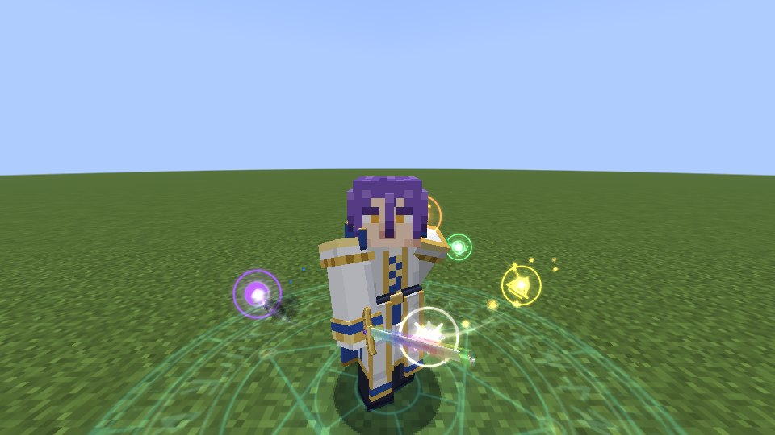
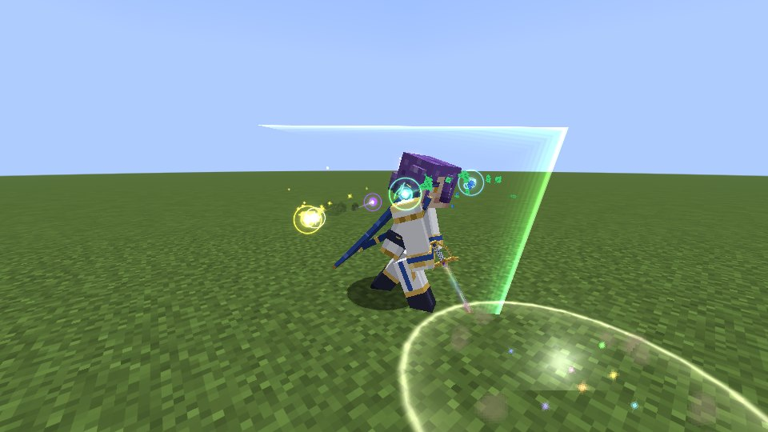
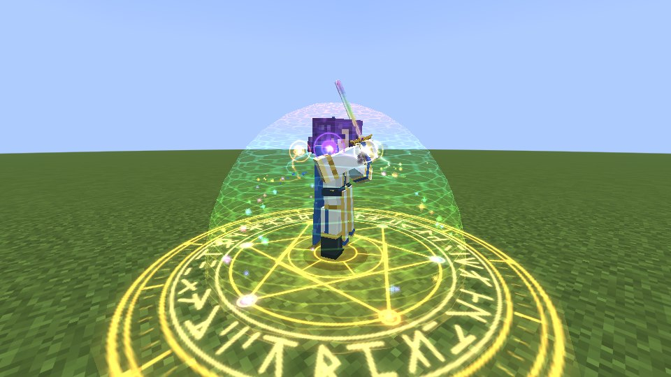
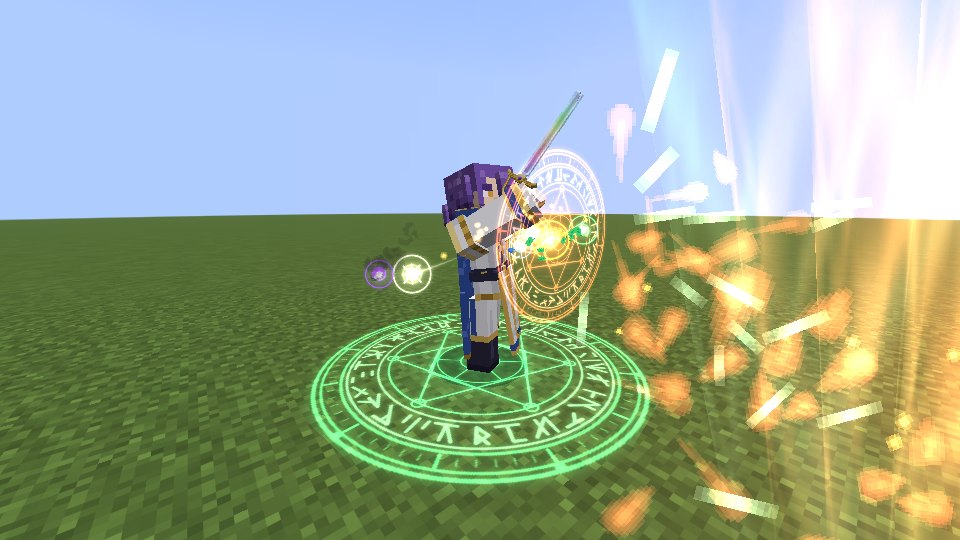
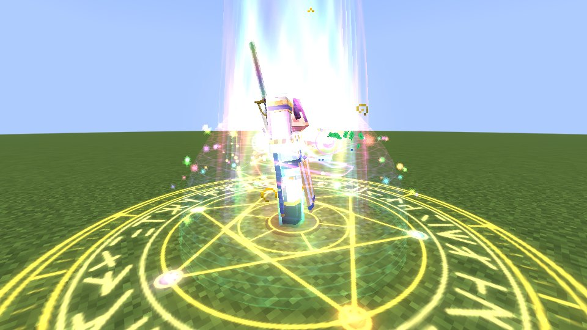
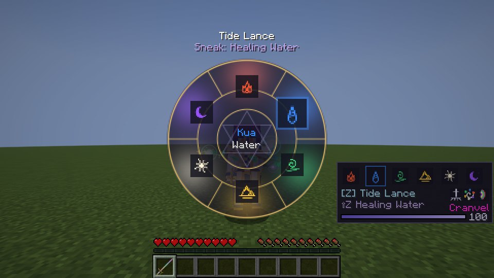
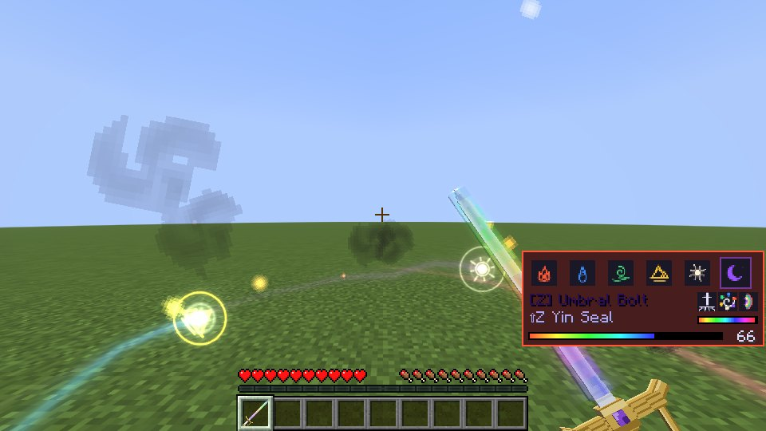

# Julius Juukulius: Finest of Knights

A Fabric mod for **Minecraft Java 1.21.11** that lets you become Julius Juukulius, the Spirit Knight of *Re:Zero*:
his Royal Guard uniform and purple hair, House Juukulius's sword, a three-hit combo with spirit-light trails, the six
quasi-spirits orbiting him, their elemental arts, Al Clauzeria and the Al Cranvel awakening.



| | |
|---|---|
|  |  |
|  |  |
|  |  |

These are unedited frames from the automated client test (software rendering, 960×540).

## Versions

| Component | Version |
|---|---|
| Minecraft | 1.21.11 |
| Fabric Loader | 0.19.2 (requires ≥ 0.19.2) |
| Fabric API | 0.141.6+1.21.11 |
| Java | 21 |
| Gradle / Fabric Loom | 9.7.1 / 1.17.21 (`net.fabricmc.fabric-loom-remap`, Mojang mappings) |

Loom 1.18 needs a Java 25 JVM to run Gradle; 1.17.21 is the newest Loom that runs on Java 21 and supports 1.21.11.

## Installing (players)

1. Install Fabric Loader 0.19.2 for Minecraft 1.21.11.
2. Put `julius-juukulius-1.0.0.jar` and Fabric API 0.141.6+1.21.11 into `.minecraft/mods`.
3. For multiplayer, the mod must be installed on the **server and every client**.

## Building from source

```sh
./gradlew build          # compiles, runs the 27 server GameTests, writes build/libs/julius-juukulius-1.0.0.jar
./gradlew runClient      # development client
./gradlew runServer      # development dedicated server (accept the EULA in run/eula.txt first)
```

The JAR in `build/libs` is the release artifact; the `-sources` JAR is optional.

### Tests

* `./gradlew runGameTest`: 27 server GameTests (also run by `build`). They cover transformation, sword grant and
  revert; the combo's chaining, impact frames, damage and mana restoration; combo reset and finisher recovery; the heavy
  strike impact frame and cooldown rejection; Al Clauzeria's barrier, projectile immunity and delayed vortex; the
  charged Al Clarista wave and its mana scaling; all twelve spirit arts; refunds when an art has no target; mana costs,
  cooldowns, regeneration delay and rates; dismissing and resummoning spirits; Aro's fall cushion; Al Cranvel's
  activation, awakening invulnerability, burst, half costs, expiry and cooldown; death, respawn and persistence.
* `./gradlew runClientGameTest`: drives a real client. In singleplayer it uses the actual key bindings for the
  transformation, combo, spirit selection (tap and wheel), all six arts, heavy strike, charge release and Al Cranvel,
  then dies and respawns. It then starts a dedicated server where a second player performs every technique while the
  client watches, verifying that other players see the transformation, animations, effects, Al Cranvel, dismissed
  spirits and the revert. Screenshots are written to `build/run/clientGameTest/screenshots`.
  Headless Linux (Mesa llvmpipe):

  ```sh
  LIBGL_ALWAYS_SOFTWARE=1 GALLIUM_DRIVER=llvmpipe LP_NUM_THREADS=2 \
    xvfb-run -a -s "-screen 0 1280x720x24" ./gradlew runClientGameTest
  ```

## Controls

All bindings are under *Options → Controls → Key Binds → Julius Juukulius*.

| Key (default) | Action |
|---|---|
| `J` | Transform / revert |
| `R` | Tap: next spirit (sneak: previous). Hold: spirit wheel (point, scroll or press 1–6, release to choose) |
| `Z` | Selected spirit's art. Sneak + `Z`: its combination art |
| `V` | Heavy strike. Sneak + `V`: Al Clauzeria |
| `B` | Al Cranvel |
| `K` | Dismiss the spirits to their crystals / summon them back |
| *unbound* | Julius settings screen |
| Attack (left click) | Sword combo, while transformed with the sword in hand (no block breaking meanwhile) |
| Use (hold right click) | Charge the sword; release to launch Al Clarista |

## Playing Julius

**Transformation.** The first transformation grants House Juukulius's sword (also craftable: amethyst shard over a
diamond, gold ingot / blaze rod / gold ingot below). Transforming plays a light-burst transition: the uniform
materialises piece by piece, the skin swaps under the flash and the six spirits emerge. Julius also moves 10% faster
while transformed. Transforming has a 2 s cooldown.

**The sword.**

| Technique | Damage | Mana | Cooldown | Notes |
|---|---|---|---|---|
| Slash 1 / 2 / 3 | 6 / 6.5 / 9 | – | – | Diagonal cut, rising backhand, leaping spin finisher. Each hit restores 2 mana. Chain within 0.2–0.75 s; the finisher is followed by a short recovery |
| Heavy strike | 14 | 10 | 4 s | Two-handed overhead cleave. With no target in reach it cracks the ground (small area hit) |
| Al Clarista (charge) | 7–17 | 15 + up to 15 | 2.5 s | Hold use for 0.4–1.5 s; release a rainbow crescent wave that pierces |

**Spirits and arts** (`Z`, sneak + `Z` for the combination art):

| Spirit | Element | Art (mana, cooldown) | Combination art (mana, cooldown) |
|---|---|---|---|
| Ia | Fire | Flame Burst (14, 3.5 s): exploding fire orb, 8 damage in 2.8 blocks, sets on fire | Ul Gora (32, 14 s): advancing spiral firestorm, repeated burning hits |
| Kua | Water | Tide Lance (16, 5 s): piercing lance, 7 per target, heals Julius per hit, Regeneration veil | Healing Water (24, 15 s): heals 6, Regeneration II, heals nearby allies |
| Aro | Wind | Gale Step (10, 2.5 s): ~9-block dash whose gusts cut (5) and push enemies on the path | El Fura (22, 10 s): wind-pressure cone, up to 7 damage and strong knockback |
| Iku | Earth | Stone Spires (18, 6 s): a line of seven spires erupting forward | Ground Shatter (24, 11 s): quake around Julius, up to 8 damage and Slowness |
| In | Yang | Radiant Burst (20, 8 s): beam of light, 8 damage (×1.5 vs undead), brief Absorption + Resistance ward | Empowerment (25, 20 s): Strength, Speed and Haste for 10 s |
| Nes | Yin | Umbral Bolt (14, 5 s): homing dark orb, 6 damage, Slowness II and Weakness | Yin Seal (26, 15 s): binds the aimed target (Slowness VI, Weakness II, Mining Fatigue) |

An art without a valid target (Yin Seal) refunds its mana and cooldown. Pressing an art while the spirits rest
summons them instead.

**Al Clauzeria** (sneak + `V`, 45 mana, 20 s). The six spirits gather on the blade while a six-element barrier dome
blocks projectiles (Resistance III while gathering); after 0.7 s Julius thrusts and releases a rainbow vortex that
bursts for up to 16 damage in 4.8 blocks.

**Al Cranvel** (`B`, needs 60 mana, costs 40, 90 s cooldown once it ends). A 1.5 s awakening during which Julius cannot
be hurt: the sword is raised to the sky, a pillar of rainbow light rises, and the sword is driven into the ground with a
6-damage burst (4.5 blocks). Then, for 20 s: arts cost half, cooldowns recover 1.6× faster, sword techniques are
1.3× faster and deal ×1.5 damage, spirit arts are ×1.25 stronger, +30% speed, higher jumps, knockback resistance and
safer falls, with a rainbow aura and the spirits circling in rainbow light. It ends with an exhausted recovery animation.

**Mana** (0–100, shown under the HUD):

* Regeneration: 10/s untransformed, 5/s transformed with the spirits out, 8/s with the spirits dismissed.
* Regeneration pauses for 1 s after spending mana.
* Every enemy hit by a combo slash restores 2 (the heavy strike restores 4).
* Death reverts the transformation and ends Al Cranvel; you respawn with 50 mana. Cooldowns are kept.
* While the spirits are out, Aro cushions falls by spending mana instead of health (if you have enough).

**HUD.** It shows the six spirits (the selected one raised, cooldown sweeps), the selected spirit's two arts with their
keys and cooldowns, the heavy strike, Al Clauzeria and Al Clarista icons, the Al Cranvel state (ready, recharging, or
remaining time) and the mana bar. It flashes red when the server rejects an action, with the reason shown above the
hotbar.

## Settings

**Client** (`config/julius_juukulius-client.json`, or the settings key): particle amount (all / reduced / minimal),
sword trails, camera shake on/off and intensity, magic circles, HUD on/off, position (beside the hotbar, bottom left,
top left, top right) and scale.

**Server** (`config/julius_juukulius-server.json`, loaded at server start): `damageMultiplier`,
`manaCostMultiplier`, `cooldownMultiplier`, `manaRegenMultiplier`, `artsDamagePlayers` (vanilla PvP and team rules
always apply too), `grantSwordOnFirstTransform`, `aroFallCushion`.

**Commands** (operators): `/julius transform <players>`, `/julius mana <players> <amount>`, `/julius reset <players>`
(full mana, no cooldowns) and `/julius info <player>`.

## How it works

* **Server-authoritative.** Clients only send intents (`ActionRequestPayload`). The server validates each one
  (transformation, sword in hand, action lock, cooldown, mana, combo timing with a 2-tick latency allowance) and owns
  damage, entities and state. Persistent state is a Fabric data attachment saved with the player; the appearance
  attachment is synced to everyone tracking the player and the stats attachment to the owner only.
* **Client prediction.** The caster's client plays its own animation, sound and cast effect immediately; the server
  sends those to everyone else and corrects or cancels the prediction when it rejects an action. Impact effects go to
  everyone.
* **Animation.** A small keyframe system (`client/anim`) blends a procedural locomotion layer (knight stance, walk,
  sprint, jump, fall, landing, charge), two crossfading action clips and a hit-flinch layer, applied after vanilla's pose
  to every humanoid model of the player (skin, outfit, armour). Clips are JSON in `assets/julius_juukulius/julius_animations`,
  so resource packs can restyle them. Torso rotation carries the arms; poses mirror for left-handed players. First person
  has its own sword-hand and casting-hand tracks.
* **Character.** A Julius skin (wide and slim), plus a 3D outfit layer: hair strand and side locks, high collar,
  pauldrons, cuffs, belt, scabbard with the sheathed hilt, and a two-segment long coat with front tails. Coat and hair
  use spring physics.
* **Effects.** Blade trails are built from the exact blade transform each frame (third and first person). The rest are
  magic circles, ring waves, beams, pillars, domes and seals, which follow their anchor entities, plus 13 custom
  particle types. All of them respect the particle setting.

Packages: `character` (state, server controller, events), `combat` (rules, sword and spirit arts), `spirit`,
`animation`, `entity`, `particle`, `registry`, `network`, `config`, `command`, `item`, and on the client `client.anim`,
`client.render`, `client.fx`, `client.particle`, `client.hud`, `client.input`, `client.config`, `mixin.client`.

### Assets

All textures, models, animations and sounds are original and generated by scripts in `tools/`, so they can be
tweaked and rebuilt (the generated files are committed; the build does not need Python):

```sh
python3 tools/gen_textures.py      # skins, outfit, sword, effects, particles, GUI, icon (numpy + Pillow)
python3 tools/gen_models.py        # sword item models; display transforms are read from BladeGeometry.java
python3 tools/gen_animations.py    # the 19 action clips
python3 tools/gen_sounds.py        # 39 synthesized sound files + sounds.json (numpy + ffmpeg)
```

## Lore notes

* **Names from the source** are used only where the effect fits: **El Fura** (wind) and **Ul Gora** (fire) follow
  Re:Zero's spell tiers; **Al Clauzeria** is Julius's art that unites all six spirits; **Al Clarista** is the six
  spirits' rainbow light clad on his sword. In the mod, the glowing blade is the clad state and the charged crescent
  wave is its long-range release. **Al Cranvel** is used for the ultimate because the request asked for it; its awakened
  state is a gameplay interpretation, not a canon depiction.
* The other arts (Flame Burst, Tide Lance, Gale Step, Stone Spires, Ground Shatter, Radiant Burst, Empowerment, Umbral
  Bolt, Yin Seal) are descriptive names for interpretations of each quasi-spirit's attribute (Kua heals, Aro is
  Julius's "propeller and cushion", In strengthens, Nes weakens), not claimed canon spells.
* The spirits' elements follow the request: Ia fire, Kua water, Aro wind, Iku earth, In yang, Nes yin.
* The sword is named "House Juukulius Sword". The source gives it no proper name, so none is invented.

## Limitations

* The look is a Minecraft-scale rendition: the body is the vanilla player skeleton with a custom skin and a box-built
  outfit layer, not a custom mesh. GeckoLib was not used because it cannot animate the vanilla player body, and the
  blade trails need the exact held-item transform.
* Mods that also replace player poses (emote or animation libraries) or the player render layers may conflict.
  Shader packs (Iris) were not tested; the additive effects use their own render pipelines.
* There is no Mod Menu integration. Open the settings with the (unbound by default) settings key, or edit the JSON file.
* The client test runs on software rendering; it has not been run on real GPU hardware here. Frame pacing,
  first-person effect placement and animation feel were tuned from offline pose previews and screenshots, not
  from live play.
* The sounds are original synthesized effects (no voice lines or audio from the anime).
* Gale Step's dash is applied by the client (like vanilla movement); the server validates its timing and resolves its
  hits.
* *Re:Zero* and its characters belong to their respective owners. This is an unofficial fan mod; the MIT license
  covers its code and original assets.
