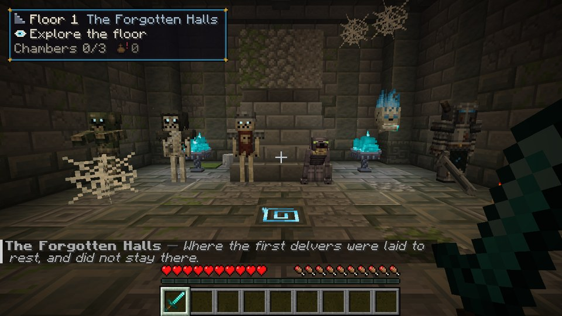
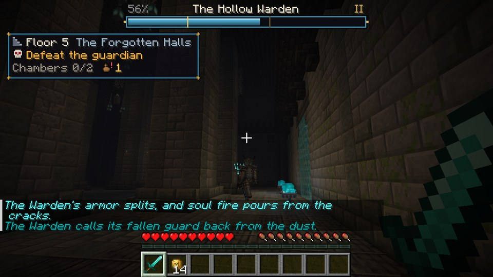
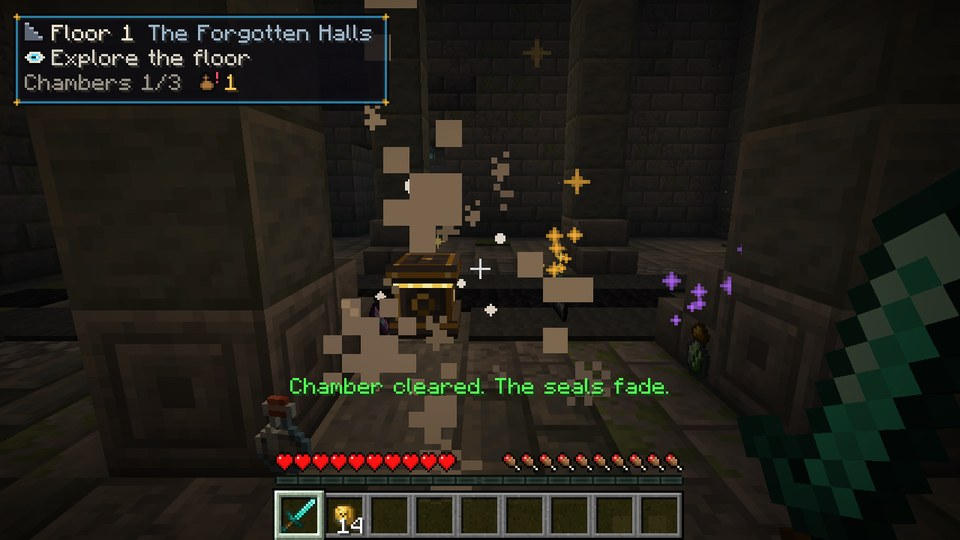
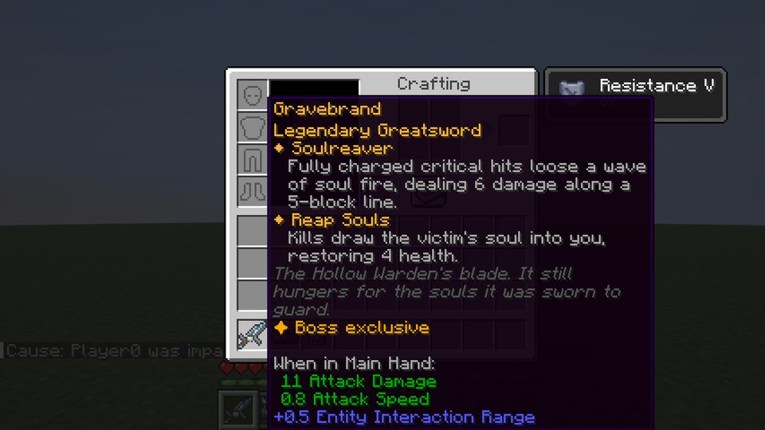

# Abyssal Descent

A roguelike dungeon mod for **Minecraft 1.21.11** on **Fabric** (Loader 0.19.2+, Fabric API 0.141+). Delvers descend
through a procedurally generated, thirty-floor dungeon of sealed chambers, traps, secrets and telegraphed boss fights.
Player combat stays 100% vanilla: weapons, armour and relics change *what happens* when a vanilla hit or arrow lands,
never how you fight.

> **Status: milestone 1 of 6.** The first zone, **the Forgotten Halls (floors 1–5)**, is complete and playable end to
> end, including its boss, the Hollow Warden. Floors 6–30 (Ashen Forge, Crystal Depths, Drowned Kingdom, Blood
> Citadel, Abyssal Throne) are designed but sealed in-game until they are built. See
> [docs/ARCHITECTURE.md](docs/ARCHITECTURE.md) for the plan.

<p align="center">
  
  
  
  
</p>

*Screenshots are captured automatically by the client gametest tour (software rendering, so no shaders or smoothing).
More in [docs/screenshots](docs/screenshots).*

## Playing

1. Craft an **Abyssal Gate** and place it anywhere in the overworld.

   ```
   C G C      C = Chiseled Stone Bricks   G = Gold Ingot
   O E O      O = Crying Obsidian         E = Eye of Ender
   C G C
   ```
2. Use the gate. It attunes for 5 seconds; everyone standing close joins the party (up to 4).
   Sneak-use cycles your starting floor once you have unlocked checkpoints.
3. Each floor is a new procedural layout. Explore, survive the sealed combat chambers, find the **Descent Rift** and
   stand in it together to go deeper. Every fifth floor is a boss floor.
4. Leave with your loot at a **Waystone** (one appears when a guardian falls) or by channelling a **Waystone Shard**.

### Death and extraction

| What happens | Loot found this expedition ("Unsecured") | Gear you brought | Permanent progress |
| --- | --- | --- | --- |
| Extract at a Waystone or with a Waystone Shard | Secured: yours to keep | Kept | Saved |
| Fall in the depths | Lost | Kept; equipped gear loses 10% durability | Kept |
| Leave any other way | Lost | Kept | Kept |

There is no death screen in the depths: a lethal blow expels you to the surface at full health. Totems and the
Gravewarden set's Deathward still get their chance first. Defeating a zone guardian unlocks the next zone as a
permanent starting floor. `/abyssal rules` prints these rules in game.

### The Forgotten Halls

| Enemy | What to watch for |
| --- | --- |
| Risen | Claws out of the floor around you; slow but relentless in groups. |
| Bone Archer | Keeps its distance and repositions after every shot. |
| Bone Shieldbearer | Blocks frontal attacks with a shield; an axe hit breaks its guard. |
| Crypt Ghoul | Crouches, then leaps; dazed for a moment if the leap misses. |
| Wailing Skull | Floats out of reach and keens before spitting soul bolts. |
| Barrow Knight | Heavy telegraphed overhead smash and a shield bash. |
| **The Hollow Warden** (floor 5) | Three phases: cleaves, ground slams, soul eruptions, a charge that stuns it if it hits a wall, soul volleys and risen minions. Every attack is telegraphed on the ground. Drops the exclusive Gravebrand and Hollow Crown. |

Elites roll one affix (Bulwark, Frenzied, Vampiric, Soulbound, Warded), each changing how the fight plays.

### Loot

Five rarities (Common, Uncommon, Rare, Epic, Legendary) with deeper floors shifting the odds upward. Higher tiers add
mechanics, not just numbers:

* **Weapons**: swords, axes, daggers, a greatsword, a bow and a crossbow with passives and procs such as Undead Bane,
  Rend (bleeding crits), Soul Flare, Stormcall chain lightning, Grave Slam shockwaves, Soulreaver waves, Soul Pierce
  arrows and Bone Shrapnel bolts. Procs need a fully charged swing, so the vanilla cooldown stays the skill check.
* **Armour sets**: *Gravewarden* (2: +2 hearts, 4: Deathward cheats death every 90 s), *Mourner* (2: +8% speed,
  4: Veil, a +40% opening strike after 3 s unharmed) and the cursed *Wraithbound* set (2: +15% melee damage but
  -2 hearts, 4: kills heal and quicken you but you take 15% more damage).
* **Relics** (active from the hotbar/off-hand, up to 3): Gravedust Locket, Vigil Candle (reveals false walls and
  traps), Blood Sigil, Cracked Phylactery, Hollow Crown.
* **Potions** (brewed from Awkward Potions): Mending (Glow Berries), Warding (Ancient Bone), Bloodrage (Ghoul Fang),
  Soulward (Soul Dust).
* Ancient Coins buy gear from the **Delver Merchant** who sometimes camps on a floor.

Treasure rooms, secret rooms behind crumbling walls, burial urns, the **Altar of Trials** (an optional harder fight for
a better reward) and the **Cursed Idol** (a gift in exchange for a curse that lasts until you leave) round out a floor.

## Commands

| Command | Who | Purpose |
| --- | --- | --- |
| `/abyssal stats` | everyone | Your expeditions, deepest floor, guardians slain, extractions and checkpoints. |
| `/abyssal rules` | everyone | The death and extraction rules. |
| `/abyssal start [floor]` | ops | Start a solo expedition without a gate. |
| `/abyssal floor <n>` | ops | Jump the current expedition to a floor. |
| `/abyssal extract` | ops | Extract immediately. |
| `/abyssal loot <chest\|treasure\|secret\|elite\|boss>` | ops | Roll a loot fountain at your position. |
| `/abyssal map` | ops | ASCII map of the current floor's rooms. |
| `/abyssal reload` | ops | Reload the config file. |

## Configuration

`config/abyssal_descent.json` is created on first launch. It covers difficulty (health/damage multipliers, per-floor
scaling, party scaling, elite chances), loot (rarity weights per source, depth shift, coin drops), rules (death
durability toll, unsecured-loot loss, dungeon block protection, party size, relic limit, gate timing) and client
presentation (camera shake and its strength, HUD, particle density, boss music).

## Building and testing

Requires JDK 21.

```
./gradlew build              # mod jar in build/libs
./gradlew runClient          # development client
./gradlew runSelftest        # headless server: generates and validates 200 floor layouts, times chunk generation
./gradlew runClientGameTest  # automated client tour that saves screenshots to run/clientGameTest/screenshots
```

The client tour needs a display; on a headless machine run it under `xvfb-run` with `LIBGL_ALWAYS_SOFTWARE=1`.

Art and audio are produced by the scripts in `tools/` (pixel-art textures, the language file, sounds). Most sound
events layer re-pitched vanilla sounds; the signature sounds (attack telegraph, boss sting, floor arrival, seal hum) are
synthesized by `tools/assets/sounds.py`.

## Compatibility

The only dependency is Fabric API. The dungeon lives in its own dimension, so overworld generation is untouched.
Explosions in the depths do not break blocks, and dungeon blocks are protected (configurable).
