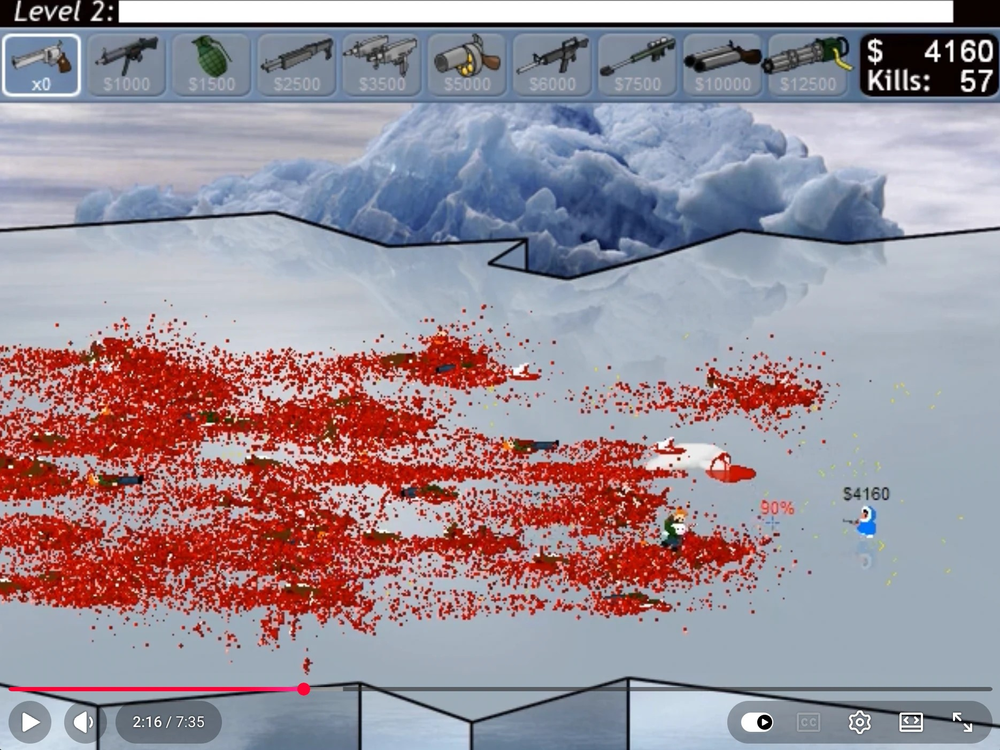

# Seal Hunter 3D

A faithful 3D recreation of **The Seal Hunter** (2005, Cute 'n Fluffy) built with
three.js, TypeScript and cannon-es. Same rules, same numbers, same 4:3 framing as
the original — rebuilt with 3D models, physics ragdolls, permanent blood on a
reflective ice floe and the original sound effects.



## Run it

Requirements: Node.js 20+ and a WebGL2-capable browser.

```bash
npm install
npm run dev          # http://127.0.0.1:5173
```

Production build:

```bash
npm run build        # type-checks, then bundles into dist/
npm run preview      # serves dist/ at http://127.0.0.1:4173
```

URL options (handy for testing): `?play` (skip the title), `?autoplay` (bot plays),
`?speed=2` (time scale), `?quality=low|medium|high`, `?nosound`.

## How to play

Animals march across the ice floe from the left. **If any of them reaches the
right edge, the game is over.** You always face and fire to the left — line up
with a creature's lane and shoot. Kills pay bounties; spend the money on better
guns from the bar at the top. Five levels, each ending with a boss, then an
epilogue.

| Action | Keys |
|---|---|
| Move | `W A S D` / arrow keys |
| Fire (hold) | `Space`, `Ctrl` or left mouse button |
| Reload | `R` |
| Buy the best weapon you can afford | `B` / `Enter` |
| Select or buy a weapon | `1`–`9`, `0`, or click its slot |
| Cycle owned weapons | `Q` / `Tab` |
| Jump (stomp crawling seals — or walk into them to kick) | `E` / `Shift` |
| Pause | `P` / `Esc` |

Gamepads work too (stick/d-pad move, A/RT fire, X reload, Y/LB cycle, RB buy, B jump, Start pause).

Tips from the original: shoot the cub out of an activist's arms and he runs away
harmlessly; wounded brown seals crawl — kick them; the polar bear speeds up as
it gets hurt; the turtle's shell deflects bullets (aim for the head, or use
explosives); get out of the walrus's lane when it starts scraping its tusks.

## Project layout

```
src/config/     original game data: weapons, enemies, levels, world scale
src/core/       pure game logic at the original 50 ticks/s (no rendering)
src/render/     three.js presentation: stage/camera, environment, models,
                ragdolls, blood, effects, debris, corpses
src/ui/         HUD, crosshair overlay, menus and screens
src/audio/      Web Audio system playing the original sound effects
src/game/       input and the application state machine
tools/          balance simulator (bot), screenshot and e2e scripts
tests/unit/     vitest unit tests for the logic
docs/           research notes, reference screenshots
```

## Tests and tools

```bash
npm test                                   # unit tests (logic, hit rules, levels, audio mapping)
npx vite-node tools/sim.ts -- 10 0.9       # headless bot balance simulation
node tools/e2e.mjs http://127.0.0.1:5173/  # headless browser run with screenshots
```

See [docs/RESEARCH.md](docs/RESEARCH.md) for the research, the original data
tables, the screenshot analysis and the reference checklist.
