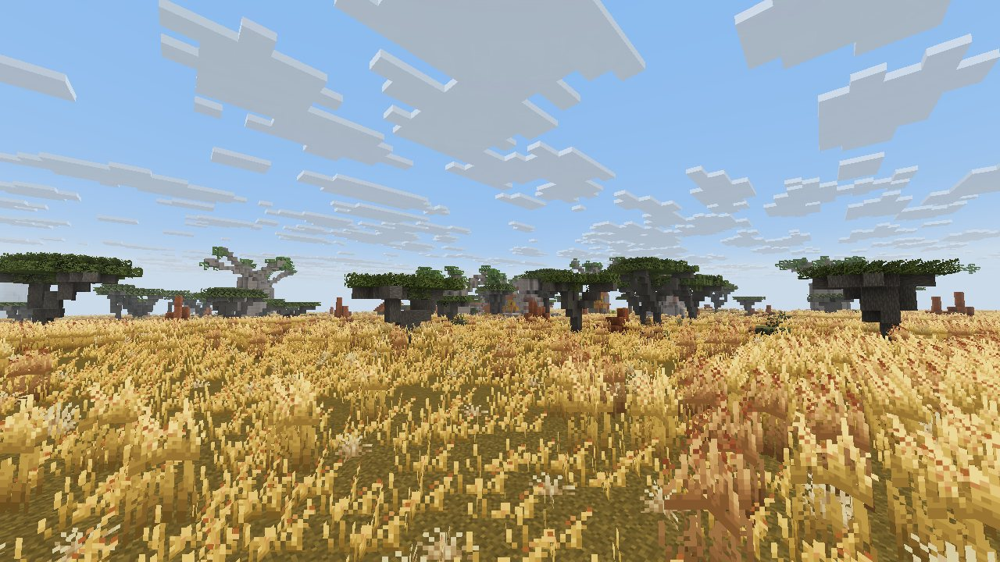
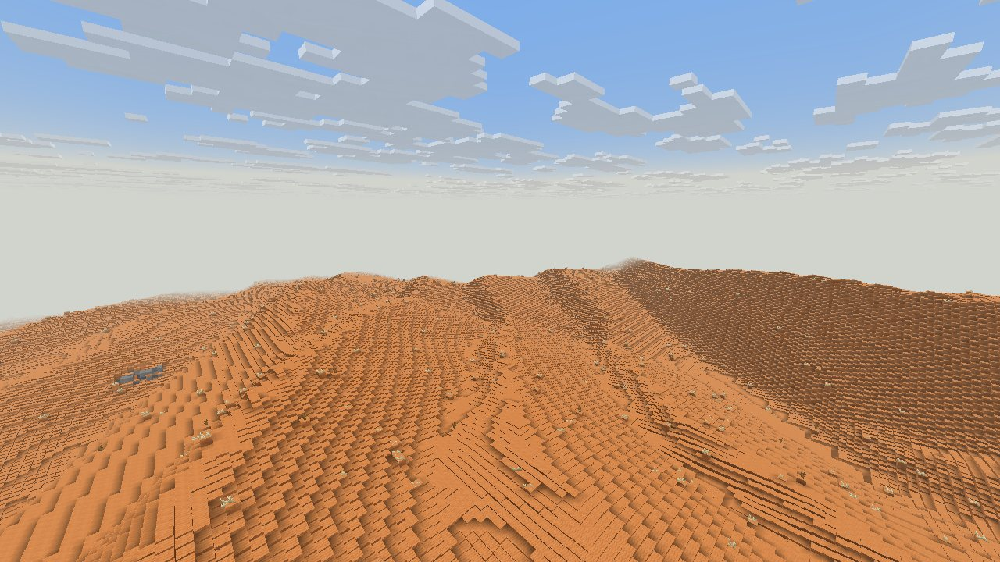
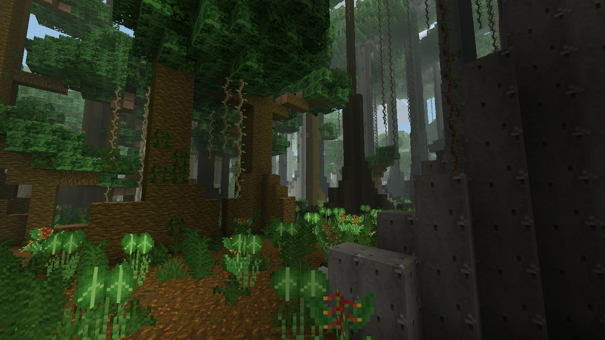
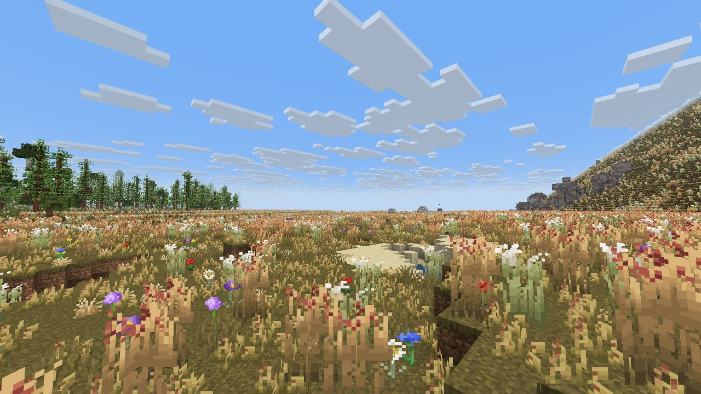
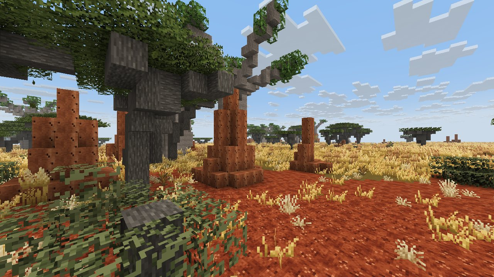
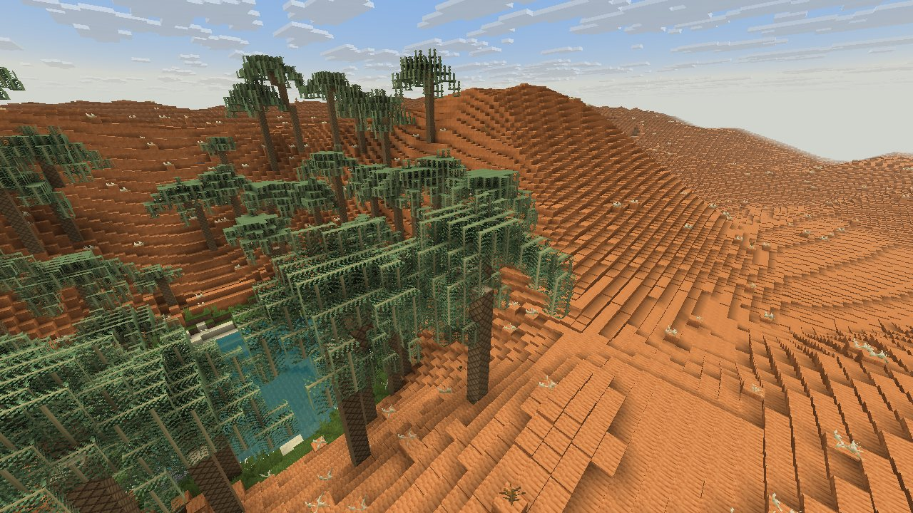
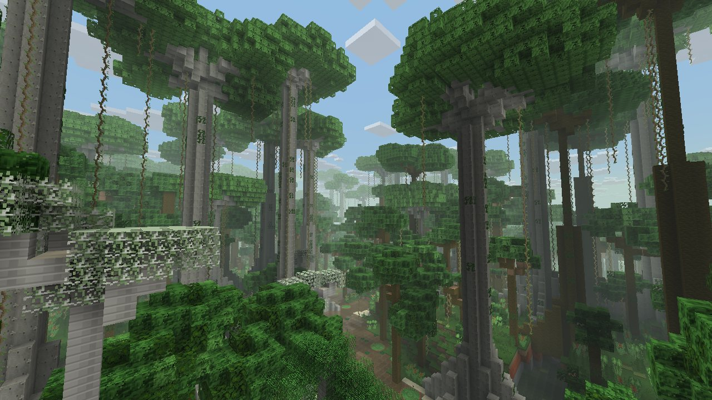
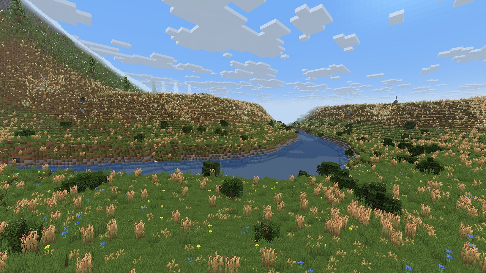
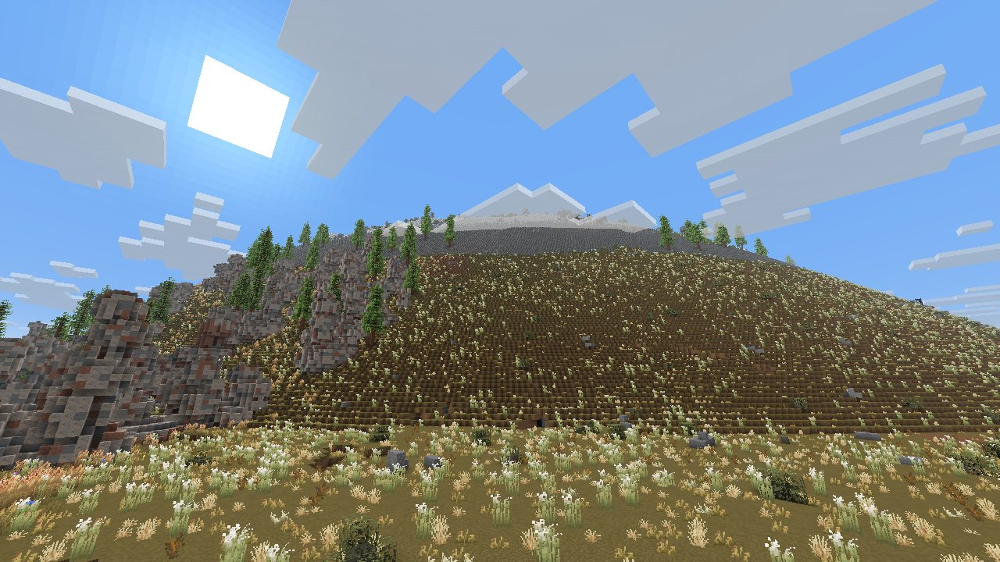
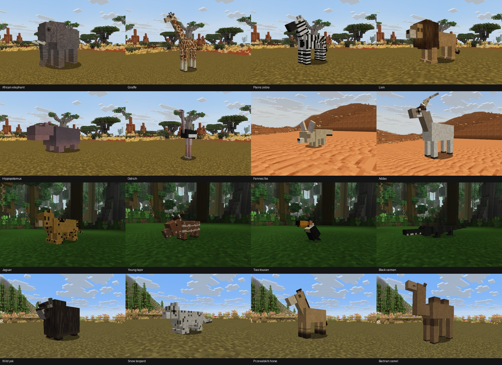

# Earthscapes

**Four new world types for Minecraft 1.21.11 (Fabric), modelled on real landscapes:**
the **African Savanna**, the **Sahara Desert**, the **Amazon Rainforest** and the **Mongolian Steppe**.

Each one is a complete overworld of its own, with its own terrain generator, biomes, trees,
plants, rocks, soils, colours and atmosphere. Pick one in the world creation screen and the
whole world is that landscape.

| | |
|---|---|
|  |  |
| *African Savanna: golden Serengeti grass under umbrella thorns and baobabs* | *Sahara Desert: the orange dune ridges of the Great Erg* |
|  |  |
| *Amazon Rainforest: buttressed giants, heliconias, giant taro and lianas* | *Mongolian Steppe: a bronze late-summer sward, larch groves on the cool slopes* |

(Unedited in-game screenshots, vanilla resource pack, rendered by the screenshot game test
described below.)

## Using it

1. Install [Fabric Loader](https://fabricmc.net/use/) (0.17 or newer) for Minecraft 1.21.11
   and put [Fabric API](https://modrinth.com/mod/fabric-api) and `earthscapes-<version>.jar`
   into your `mods` folder.
2. **Create New World → World → World Type** and cycle to *African Savanna*, *Sahara Desert*,
   *Amazon Rainforest* or *Mongolian Steppe*.

On a dedicated server, set one of these in `server.properties` before the world is created:

```properties
level-type=earthscapes\:african_savanna
level-type=earthscapes\:sahara_desert
level-type=earthscapes\:amazon_rainforest
level-type=earthscapes\:mongolian_steppe
```

The Nether and the End are unchanged; strongholds, mineshafts, trial chambers, ancient cities
and (where they fit) villages, desert pyramids and jungle temples still generate, so the worlds
remain fully playable.

## The world types

### African Savanna
Endless golden grassland in the style of the Serengeti, under scattered umbrella-thorn acacias
with their flat, spreading crowns.



| Biome | What you find |
|---|---|
| Serengeti Plains | sea of tall golden and red-oat grass, lone umbrella thorns, thornbush, termite mounds |
| Acacia Woodland | denser acacia stands and greener grass, also on the foothills |
| Tsavo Red Earth | red laterite soil between dry grass, tall termite mounds, commiphora bush, baobabs |
| Baobab Savanna | groves of massive bottle-shaped baobabs |
| Kopje Plains | granite kopjes: whaleback domes stacked with split boulders and candelabra euphorbias |
| Rift Highlands | eroded ridged mountains that rise blue and hazy on the horizon |
| Fever Tree Riverine Woodland / Savanna River | meandering rivers lined with yellow-barked fever trees, watering holes |

### Sahara Desert
A great sand sea of orange dunes with sharp, rippled crests, built from intersecting dune ridges
(transverse, linear and star dunes up to ~50 blocks high). Wind-blown sand is draped in partial
**sand layers**, so dune slopes are smooth curves rather than block staircases.



| Biome | What you find |
|---|---|
| Great Erg / Sahara Sand Sea / Erg Margin | mega-dunes, smaller dune fields, sand sheets with drinn grass tufts |
| Sahara Oasis | a turquoise spring pool in a sand hollow ringed by date palms bearing dates |
| Reg Gravel Plain | flat desert pavement of dark wind-polished pebbles |
| Hamada Plateau | dark, varnished rock tablelands with stepped cliffs |
| Hoggar Mountains | black basalt and tuff volcanic peaks |
| Tassili n'Ajjer Stone Forest | dissected sandstone plateau with banded rock pillars and natural arches |
| Sahara Wadi | dry valleys with desert acacias and tamarisk |
| Chott Salt Flat | white, polygon-cracked salt crust |

### Amazon Rainforest
Flat, endless lowland rainforest with a closed canopy, emergent giants and enormous rivers.



| Biome | What you find |
|---|---|
| Amazon Rainforest | multi-storey forest: canopy trees on buttress roots, understorey, ferns, heliconias, giant taro, leaf litter, lianas, bromeliads |
| Emergent Rainforest | kapok and Brazil-nut giants (40–58 blocks) towering above the canopy |
| Amazon River / Blackwater River | very wide café-au-lait rivers and tea-black tributaries with white sand banks |
| Várzea / Igapó Flooded Forest | forest standing in shallow water, açaí palms, cecropias, giant Victoria water lilies |
| Buriti Palm Swamp | fan palms rising from swamp water |
| Rainforest Hills | forested hills with bamboo |

The air is humid and hazy and the soil under the litter is red laterite, exposed on banks.

### Mongolian Steppe
Rolling hills of feather grass and bronze-red seed heads below colossal snow-capped massifs.




| Biome | What you find |
|---|---|
| Feather Grass Steppe | the open steppe, ovoo cairns on hilltops, gers (yurts) on level ground |
| Gobi Dry Steppe | sparse yellow grass, gravel, saxaul scrub, camels |
| Larch Forest Steppe | Siberian larch forest that grows only on cool north-facing slopes |
| Steppe River Valley / Steppe River | broad meandering valleys with willow scrub |
| Granite Tors | weathered granite rock piles |
| Alpine Meadow | green high pastures full of edelweiss and pasque flowers |
| Altai Mountains | ridged ranges and broad volcanic massifs up to ~y 290, with scree, snowfields and glacier ice |

## Animals

Each world has its own wildlife, 25 new animals in all, spawning in the biomes where they
belong:

| World | Animals |
|---|---|
| African Savanna | African elephant, giraffe, plains zebra, blue wildebeest, Thomson's gazelle, lion (maned males and lionesses), ostrich, hippopotamus and Nile crocodile in the rivers |
| Sahara Desert | fennec fox, addax, dorcas gazelle, wild dromedaries (vanilla camels, now spawning on the dunes), desert hares |
| Amazon Rainforest | jaguar, capybara, South American tapir (with striped young), toco toucan, Amazon river dolphin and black caiman, alongside macaws (parrots), ocelots and armadillos |
| Mongolian Steppe | wild yak, saiga, Mongolian gazelle, snow leopard, Tarbagan marmot, Przewalski's horse (takhi), Bactrian camel, plus the herders' horses and sheep, wolves and foxes |



They behave like their real counterparts:

* Grazers live in **herds** that keep together, stop to graze, and **flee from predators**.
  Antelopes, zebras, giraffes and ostriches also run from players, unless you **sneak** up on them.
* **Lions, jaguars and snow leopards hunt** their natural prey when hungry, then rest for a
  while; they fight back if attacked, but do not go after players.
* **Elephants, hippos and yaks** are peaceful until provoked, and then the whole herd defends itself.
* **Crocodiles and caimans** lurk in rivers and ambush animals, and players, at the water's edge.
* Animals have displays: an elephant raises its trunk to trumpet, a hippo yawns, a crocodile
  gapes, a lion roars, and a marmot stands up on its hind legs to whistle an alarm.
* Zebras and Przewalski's horses can be tamed and ridden like horses (they are wilder),
  Bactrian camels like camels; toucans perch like parrots, fennecs behave like foxes.
* All of them can be bred with suitable food (grass-eaters with wheat, browsers with leaves or
  apples, predators with raw meat, crocodiles with fish) and have spawn eggs.

## New blocks and items

* **Plants:** golden grass, tall golden grass, red oat grass, drinn grass, feather grass,
  steppe grass, tall steppe grass, edelweiss, pasque flower, heliconia, giant taro, bromeliad
  (grows on branches too), liana (climbable), giant water lily pad (3×3, walkable).
* **Trees with saplings:** umbrella thorn, fever tree, baobab, date palm (with harvestable
  dates), kapok, larch. Baobab, date palm, kapok and larch come with log, wood, stripped
  variants, planks, stairs, slabs, fences and fence gates.
* **Other wood/leaves:** cecropia, açaí palm, buriti palm fronds, rainforest leaves,
  thornbush leaves, candelabra euphorbia.
* **Ground and rock:** Sahara sand (+ layers), Sahara sandstone, hamada stone, desert pavement,
  salt crust, laterite, termite mound, kopje granite.
* **Food:** dates.

Recipes cover planks, wood, stairs, slabs, fences, gates, sandstone, sand layers, dyes from the
flowers, glass from Sahara sand, bricks from laterite and terracotta from termite mounds.

## Building

Requires Java 21.

```sh
./gradlew build          # -> build/libs/earthscapes-1.0.0.jar
```

All textures, models, loot tables, recipes, tags and worldgen JSON are generated by the
Python scripts in `tools/` (Python 3 with Pillow and numpy) and committed, so a normal build
does not need Python. To regenerate them, extract the vanilla 1.21.11 client jar somewhere and
run:

```sh
tools/generate_all.sh <extracted client jar directory>
```

(`tools/gen_mobs.py` regenerates only the animals and needs no vanilla files.)

## How it works

* Each world type is a datapack-style **world preset** (listed through the
  `minecraft:normal` world preset tag) with its own noise settings, multi-noise biome list,
  surface rules and noise router.
* Terrain is a height field written in density functions, using four custom density function
  types: `earthscapes:dune_ridges` (asymmetric, warped dune ridges), `earthscapes:eroded_noise`
  (derivative-damped "eroded" fractal noise for mountains), `earthscapes:terrace` (mesas and
  escarpments) and `earthscapes:cell_bumps` (isolated landforms such as volcanic massifs,
  oases and watering holes). Biome climate parameters are derived from the same functions,
  so biomes line up with the landforms.
* Trees, rocks and structures are procedural Java features (umbrella acacia, baobab, kapok
  with buttresses, broadleaf canopy trees, palms, cecropia, larch, shrubs, boulders/kopjes,
  hoodoos and arches, termite mounds, gers, ovoo cairns, giant lily pads) configured from JSON.
  Leaves are written with correct distances so canopies do not decay.
* A ground-cover feature carpets each chunk with plants in one pass, a surface-smoothing
  feature turns dune tops into sand layers that match the exact sub-block terrain height, and
  slope/peak placement filters put larches on north slopes and cairns on summits.
* The animals are generated by `tools/gen_mobs.py`: their models are written in a small box
  geometry language that emits the Java model layers, and their coats are painted by shaders that
  colour each texel by its 3D position on the model, so stripes, patches and rosettes run
  continuously over the body. Most animals share one data-driven entity class whose behaviour
  comes from a species description; the zebra and takhi build on the vanilla horse, the fennec on
  the fox, the toucan on the parrot, the Bactrian camel on the camel and the river dolphin on the
  dolphin, keeping their vanilla animations.

### Development tools

Not part of the mod jar:

* `tools/dev/survey.sh <preset>` – samples terrain height and biomes over an 8×8 km area
  without generating chunks and renders maps (fast, for tuning biome proportions).
* `tools/dev/mapdump.sh <preset>` – generates chunks on a headless server and renders top-down
  terrain, ground and biome maps.
* `tools/dev/screenshots.sh [world types] [seed] [render distance]` – runs the real client (under
  Xvfb with software OpenGL when there is no display) through a Fabric client game test that
  creates each world type, finds characteristic biomes, places the camera (on open ground, or at
  a vantage point with a view of a summit) and saves screenshots to
  `build/run/clientGameTest/screenshots`. With `ZOO=true` it photographs every animal instead,
  and with `AITEST=true` it watches a hunt, a herd and a crocodile ambush and logs what happens.

## License

MIT
