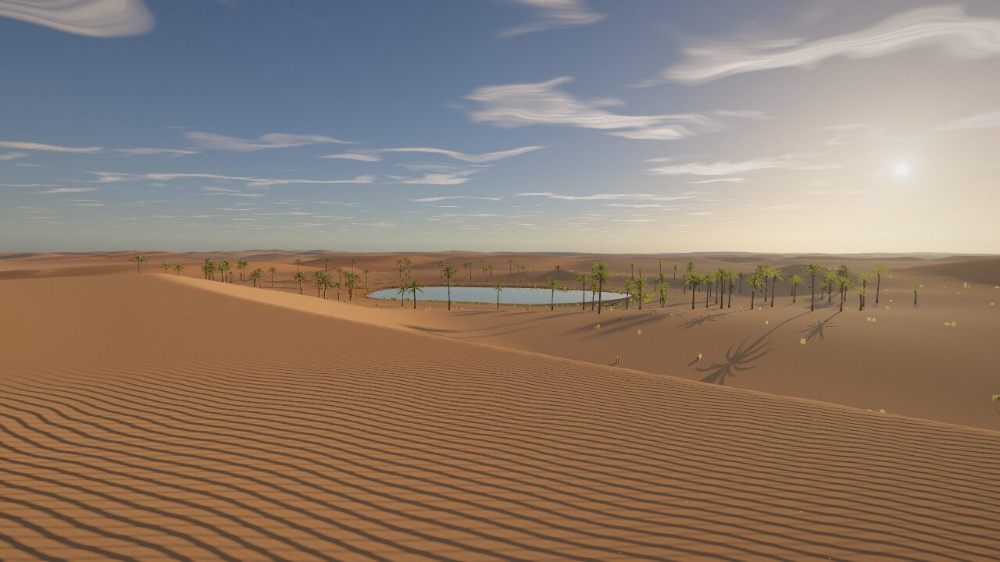
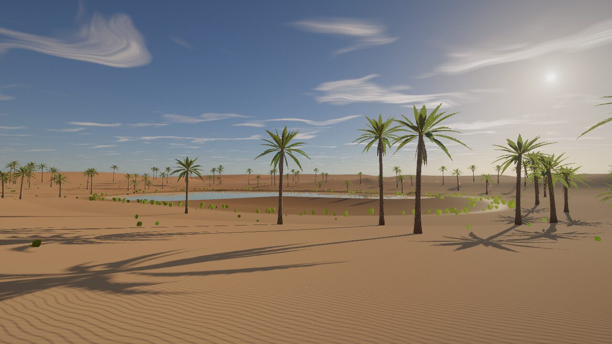
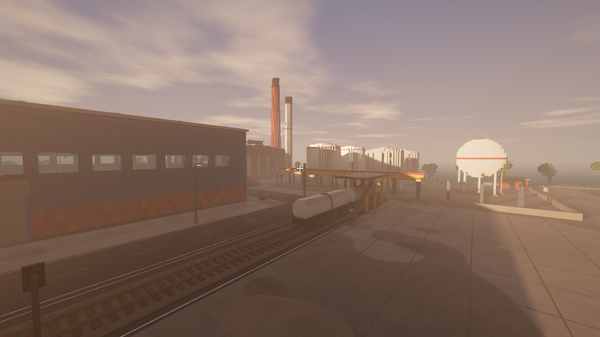
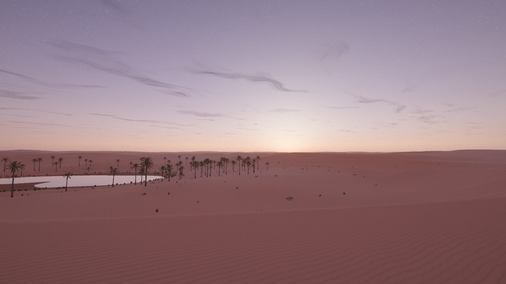
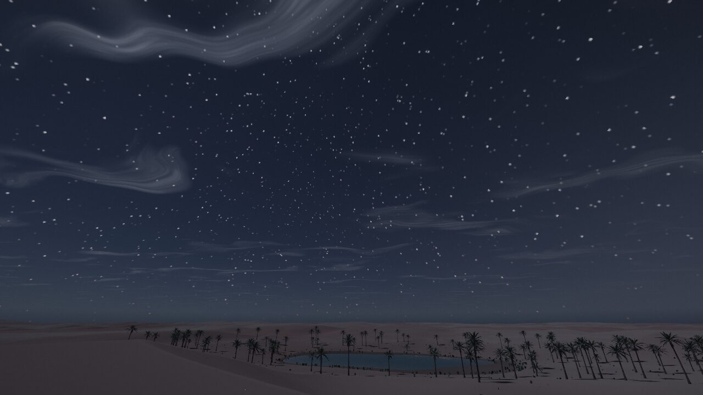
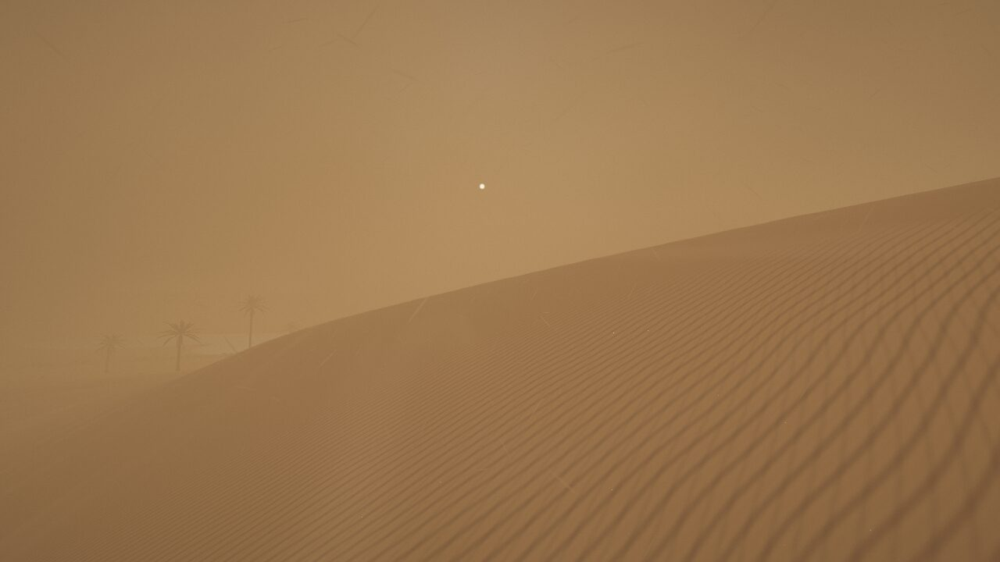
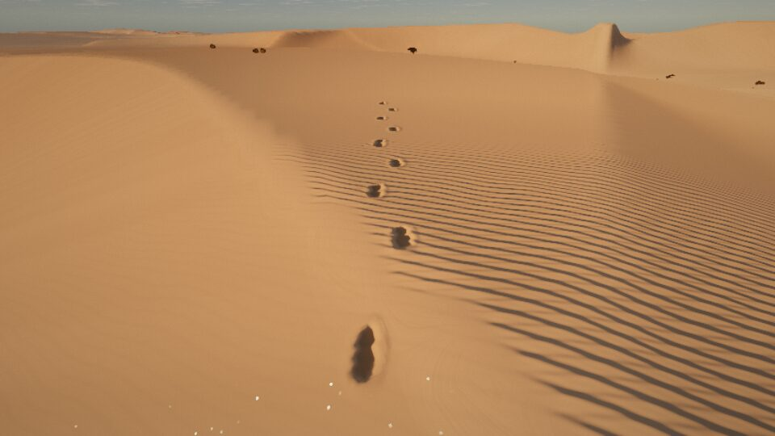

# Sahara Wanderer

A first-person walking simulator set in an endless, procedurally generated Saharan erg,
modelled on Erg Chebbi in Morocco (31°08′N 4°01′W). Walk barchanoid dunes from golden
hour into a moonlit night, follow palm groves to oasis lakes, climb a crest for the view,
and wait out a sandstorm. It runs in the browser with three.js and WebGL 2, and ships no
image or audio files: every texture, model and sound is generated at startup.



| | |
|---|---|
|  |  |
|  |  |
|  |  |

## Running it

```sh
npm install
npm run dev        # http://localhost:5173
npm run build      # static site in dist/
npm run preview    # serve the production build
```

Any modern desktop browser with WebGL 2 works (Chrome, Edge, Firefox, Safari 15+).
Phones and tablets get touch controls and the low preset.

## Controls

| Input | Action |
| --- | --- |
| `W` `A` `S` `D` / arrows | Walk |
| `Shift` | Run |
| `Space` | Jump |
| Mouse | Look (click the view to capture the cursor) |
| `[` / `]` | Turn time back / forward while held |
| `F` | Photo mode: fly freely, `Space` up, `C` down |
| `H` | Hide the field notes (HUD) |
| `M` | Mute |
| `T` | Frame-rate readout |
| `Esc` | Pause menu and settings |

Touch: drag on the left half to walk, on the right half to look; Run toggles running.
Gamepad: left stick walks, right stick looks, A jumps, a shoulder button runs, Y toggles
photo mode, Start pauses.

## What's in the desert

**Terrain**
- A dune field with three scales. Barchanoid ridges have long windward slopes and slip
  faces held at the sand's angle of repose (about 33°), with crescent arcs whose horns
  taper downwind. Ridged-noise megadunes rise to over 100 m, and small oblique
  dunes appear in patches. The prevailing wind blows from the north-east, as the
  Saharan trade winds do, so every slip face points south-west.
- Interdune lakes (oases) appear on a coarse random grid. Their basins are elongated
  along the interdune corridors.
- The world is seamless and unbounded. Terrain streams around you out to 20–30 km,
  depending on the preset, and sinks below the horizon with the Earth's curvature.

**Light and sky**
- A physically based atmosphere (Hillaire 2020) with Rayleigh, Mie and ozone, plus
  Saharan dust that turns the haze ochre and thickens with the weather.
- Real solar geometry for 31° N in mid-October, so the sun sets in the west-south-west.
  A waxing gibbous moon is already up in the east at sunset.
- Long, soft dune shadows ray-marched through the terrain on the GPU, plus cascaded
  shadows for palms, shrubs and your own body, so you see your shadow walk at sunset.
- Cirrus clouds lit through the atmosphere. Stars and the Milky Way wheel around the
  celestial pole through the night; the moon's lit side faces the sun.
- Auto-exposure computed on the GPU, with partial adaptation so sunsets stay warm and
  nights stay dark.

**Sand**
- Wind ripples about 11 cm apart, perpendicular to the dune-forming wind, plus a weaker
  oblique set. They are absent on slip faces, which show avalanche grainflow streaks
  instead.
- Quartz glints, lighter wind-sorted crests and darker coarse troughs, damp sand at the
  waterline, and sheets of sand drifting downwind on windy days.
- Footprints with raised rims, toe-dig when running, and walls that cast shadows at low
  sun. The wind slowly fills them in.

**Life and weather**
- Procedural date palms in groves, with crowns that droop with age and skirts of dead
  fronds. Desert grass tufts and twiggy shrubs grow in interdune hollows, and sedges
  line the shore. All of it sways and flutters in the wind.
- Oasis water absorbs red light with depth, reflects the sky and the surrounding dunes
  (found by ray-marching the terrain), and catches sun glints.
- Weather moves between clear, breezy, windy and sandstorm, either on its own or set by
  hand. Gusts drive grass, sound, blowing sand and drifting dust. Saltating grains
  bounce along the surface and stream off dune crests. Storms build over about a minute
  and close visibility to around a hundred metres.

**Sound** (synthesised with WebAudio)
- Wind with a rumble, whoosh and whistle that follow the gusts and pan with the wind
  direction relative to you, plus the hiss of moving sand.
- Granular sand footsteps for walking, running, landing and splashing.
- A swish when you slide down a slip face. Keep sliding and you may hear the low boom
  of a "singing dune", a sound real Saharan dunes make.
- Positional oasis ambience (water, palm rustle, birds by day) and crickets at night.

## Graphics settings and performance

Quality defaults to **Auto**: a preset is chosen from the GPU, and adaptive resolution
then trims the render scale to hold the frame rate. Everything can be changed in
Settings.

| Preset | Render scale | Anti-aliasing | Terrain clipmap | Shadows | Sand particles | Vegetation radius |
| --- | --- | --- | --- | --- | --- | --- |
| Low | 72 % | FXAA | 256² × 10 levels | Terrain only | 2.5k | 130 m |
| Medium | 85 % | FXAA | 384² × 10 levels | + objects (1536²) | 7k | 200 m |
| High | 100 % | 4× MSAA | 512² × 10 levels | + objects (2048²) | 14k | 280 m |
| Ultra | 100 % (DPR 2) | 4× MSAA | 512² × 10 levels | + objects (3072²) | 24k | 380 m |

How the frame stays cheap:
- **Terrain heights come from a GPU clipmap.** The heightfield is evaluated in a
  fragment shader into ten nested levels, which regenerate only when you have walked
  far enough. Coarse levels are band-limited (dune components fade to their mean as
  their wavelength approaches the texel size), so distant dunes never alias into stair
  steps.
- **The terrain mesh is CDLOD.** A quadtree of instanced grid patches with continuous
  vertex morphing gives no cracks and no popping in two draw calls. Each vertex samples
  the clipmap level that matches its spacing.
- **Shading normals and shadows are per pixel**, read from filtered atlases. The far
  field can have coarse geometry and still look sharp.
- **Dune shadows are cached.** They are recomputed only when a level moves or the sun
  shifts, finest levels first.
- **Vegetation is instanced** and sorted by distance. Palms switch to a 300-triangle
  LOD beyond 150 m, and each shadow cascade draws only casters that can reach it
  (accounting for long low-sun shadows).
- **Blowing sand is stateless.** Each particle's position is a pure function of its
  seed, the integrated wind and the terrain, so there is no CPU work per particle.
- **Rendering is HDR with pre-exposure** (half-float targets stay precise at night),
  energy-conserving bloom with firefly suppression, AgX tone mapping, and dithering
  against banding.

## Project layout

```
index.html                    page, menu, HUD and touch-control markup and styles
src/main.js                   boot sequence, loader, audio wiring, hot reload support
src/game.js                   owns the world, player and per-frame update order
src/settings.js               graphics presets and saved preferences
src/engine/                   renderer, HDR pipeline, post-processing, shared uniforms
src/shaders/                  shared GLSL: clipmap sampling, sand model, shadows
src/world/heightfield.js      the dune function, in JavaScript and GLSL side by side
src/world/terrain/            clipmap atlas, CDLOD mesh, terrain material
src/world/atmosphere.js       sky LUTs, lighting probe, aerial perspective
src/world/sky.js              sun, moon, stars, cirrus, storm sky
src/world/vegetation/         procedural textures, palm and plant geometry, streaming
src/world/oases.js            lakes and water shading
src/world/weather.js          weather states, gusts, wind
src/world/particles.js        blowing sand, dust and footstep kicks
src/world/footprints.js       deformation map for footprints
src/player/                   input, walking physics, shadow-casting body
src/audio/audio.js            procedural soundscape
src/ui/ui.js                  menu, settings, HUD, touch controls
src/dev/                      developer checks
```

The heightfield exists twice, in JavaScript (collision, plant placement) and GLSL (GPU
atlas). Both use the same integer PCG hash, so they agree to within about 2 mm anywhere
in the world. Open `/?validate` and read `window.__sahara.validation` to check this on
your GPU.

### Developer URL parameters

| Parameter | Effect |
| --- | --- |
| `q=low\|medium\|high\|ultra` | Force a preset |
| `set.<key>=<value>` | Override one preset field, e.g. `set.msaa=0` |
| `time=17.4` | Start at a time of day (and freeze the clock) |
| `weather=sandstorm` | Start in a weather state |
| `x=…&z=…&yaw=…&pitch=…` | Start position and view (yaw is a compass bearing) |
| `h=40` | Start in photo mode, this many metres above the ground |
| `dbg=1…6` | Terrain debug views: shadow, normals, height bands, clipmap levels, slip faces and curvature, footprints |
| `play` | Skip the menu |
| `validate` | Compare the GPU and JavaScript heightfields |
