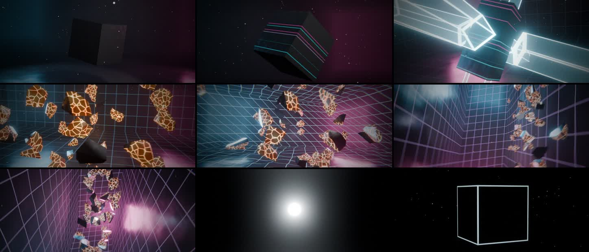

# GLITCH CUBE: a 60-second procedural Blender animation

A lone cube floats in a dark studio. It starts to rotate, then it glitches,
duplicates itself, stretches, fractures into floating shards and warps the
space around it. Gravity reverses, the shards move in impossible ways, and the
whole scene collapses into a singularity before snapping back to its original
state.

The scene, animation, simulation, lighting, compositing and soundtrack are all
generated from code. No external assets are used.



**Watch:** [`glitch_cube.mp4`](glitch_cube.mp4) (60 s, with sound)

* `glitch_cube.py`: builds the whole Blender 4.5 scene and writes a `.blend`, plus audio cues as JSON
* `soundtrack.py`: synthesises the 48 kHz stereo soundtrack (numpy only), synced to the cues
* `render.sh`: builds, renders (multi-process, resumable) and encodes the final MP4
* `cues.json`: glitch schedule and shard impact times exported from the simulation
* `glitch_cube.mp4`: the rendered film (960×408, 2.35:1, 24 fps, H.264 + AAC)

## Storyboard

| Time | Beat | What happens |
|---|---|---|
| 0–6 s | **Dark studio** | Black room. A key light stutters on like a real studio light. Cube edges catch the light and the cube starts to turn. Slow dolly in. |
| 6–13 s | **Glitch** | More and more digital faults: position and rotation snaps, axis stretches, RGB-split ghost copies, scanline emission on the cube, lens dispersion, light flicker, and flashes of a hidden grid in the walls. Ends in a 0.75 s glitch burst. |
| 13–21 s | **Duplicate & stretch** | Six holographic echoes spring out along the axes, stretch into long bars while the cube squashes like jelly, orbit through each other, then get sucked back in. The cube trembles and glows under pressure. |
| 21–30 s | **Fracture** | The cube bursts into 42 Voronoi shards with glowing molten veins. A shockwave ring runs across the grid and the shards float and orbit. |
| 30–38 s | **Space distortion** | The studio twists, buckles and breathes (twist + displacement modifiers). The grid lights up and the camera does a dolly-zoom (vertigo shot). The rim lights strobe. |
| 38–42 s | **Gravity reverses** | Shards drop and bounce on the floor, then gravity flips. They fall *up* onto the ceiling while the camera rolls 180°, so the ceiling becomes the floor. Impacts are simulated per shard. |
| 42–46 s | **Impossible motion** | The shards lift off and flow along a trefoil knot through the room while the camera keeps rolling. Midway, time rewinds for a moment. |
| 46–52 s | **Collapse** | Room, shards and dust spiral inwards. The room folds itself into a sphere and shrinks to nothing, leaving a heartbeat-pulsing singularity in the void. It inhales... |
| 52–53 s | **Snap** | ...and everything snaps back at once: a flash and a shockwave, the room springs open, and the shards reassemble elastically into the cube with an audible lock. |
| 53–60 s | **Resolution** | Calm again. The cube slows and settles exactly back on its opening pose with a final "click" glint. The studio lights switch off one by one, leaving only a fading afterglow of the cube's edges. |

## Techniques

* **Voronoi fracture with bmesh**: each cell starts as the cube and is cut by
  the bisector plane against every other seed point (`bisect_plane` +
  `holes_fill`). Cut faces get the molten core material, so when the pieces
  are put back together they form the cube exactly. That is why the snap-back
  swap is invisible.
* **Custom shard physics**: a small rigid-body integrator (4 substeps per
  frame) switches its force field per beat: initial burst with drag, springs to
  orbiting float targets, twisted spiral targets, gravity down, gravity up with
  per-vertex floor and ceiling collision, springs to a moving trefoil knot (with
  a rewind), and an implosion. Everything is baked to keyframes, so the
  `.blend` plays back deterministically with no caches.
* **Per-frame baking**: every animated value (transforms, light energies,
  shader values, modifier settings, compositor inputs, exposure) comes from a
  Python function of time and is written straight into F-curves with
  `foreach_set`. The baker uses the Blender 4.4+ slotted-action channelbags.
* **Procedural shaders**: scanline glitch bands driven by a per-frame random
  phase, box-edge glow from Generated coordinates, holographic Fresnel echoes,
  additive RGB ghosts, Voronoi-vein shard cores, and a studio grid drawn from a
  stored `rest` position attribute so it warps with the room.
* **Geometry Nodes dust**: 380 motes generated in a node group. A baked
  "gravity" offset (wrapped with floored modulo) and a "collapse" factor drive
  them, so they fall up and get sucked into the singularity too.
* **Camera**: time-parameterised Hermite spline. On top of it sit a true
  dolly-zoom (focal length tied to subject distance), gravity rolls, noise
  shake keyed to impacts, and an exponential whip back to the opening framing.
  Depth of field tracks the subject.
* **Look**: EEVEE (Next) with screen-space ray-traced reflections, volumetric
  haze, motion blur, AgX colour, and compositor bloom plus animated lens
  dispersion and distortion. ffmpeg adds film grain and a vignette at encode.
* **Sound**: drone with physics-linked pitch bends, studio light clicks and
  mains hum, glitch stutters taken from the same glitch schedule, glass
  shatter, crystal chimes, a vertigo tone pair for the dolly-zoom, per-shard
  impact sounds from the simulation, an arpeggio that plays backwards during
  the rewind, a collapse riser, heartbeat, snap and lock-in, and a resolving
  D major add9 pad.

## Reproduce

Requires Blender **4.5 LTS**, ffmpeg and python3 with numpy.

```bash
# Install Blender 4.5 LTS (Linux x64)
curl -L -o blender.tar.xz https://download.blender.org/release/Blender4.5/blender-4.5.15-linux-x64.tar.xz
tar xf blender.tar.xz -C /opt && ln -sf /opt/blender-4.5.15-linux-x64/blender /usr/local/bin/blender
```

```bash
./render.sh out 2          # work dir, number of parallel Blender processes
```

To open the scene interactively instead:

```bash
blender -b --factory-startup -P glitch_cube.py -- glitch_cube.blend && blender glitch_cube.blend
```

The final render used 10 EEVEE samples at 960×408. Raise `taa_render_samples`
and the resolution in `glitch_cube.py` for a higher-quality pass if you have a
GPU. On a GPU, EEVEE renders this scene in a few minutes. The CPU/llvmpipe
render took about 3 hours.
