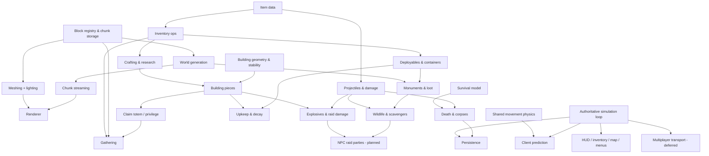

# CORRODE — Feature Dependency Map & Milestones (Deliverables D + E)

## Feature dependency map

Read it as "must exist before": e.g. raiding needs building pieces *and* the combat damage pipeline;
privilege zones gate gathering (no digging under claimed walls); persistence depends on every system's
records being serialisable.

## Milestones

Each milestone has a completion criterion that is checked by an automated test, the e2e smoke run, a
benchmark, or a screenshot review. Status is as of the end of this session — see VERIFICATION.md for the
evidence.

| # | Milestone | Completion criteria | Status |
|---|---|---|---|
| 1 | Technical foundation | Explore, mine and place blocks in a streamed voxel world; tests + profiling exist | **Done** — e2e spawns in ~1–2 s, mining/placing via the simulation, benchmarks |
| 2 | Survival loop | gather → craft → survive → die → recover body; saves | **Done** — playtested in browser; covered by tests |
| 3 | Building & progression | foundations → walls/doors/floors, tiers, stability, totem/upkeep, workbenches, research, basic raiding | **Done** (raid table matches research ratios) |
| 4 | Simulation foundation (was "multiplayer foundation") | authoritative sim with prediction/reconciliation, persistence, reload correctness | **Done** for singleplayer; multiplayer transport **deferred** by the owner |
| 5 | Combat & exploration | weapons/ammo/armor/healing, loot containers, monuments, wildlife, scavenger NPCs, sound | **Done** — 7 monuments, all loot reachable (tested) |
| 6 | Complete sandbox | progression balance, building/raiding polish, more biomes/monuments, environment & audio polish | **Partial** — NPC raid parties, soft/hard sides, electricity planned |
| 7 | Optimization & release prep | profiling on real GPUs, accessibility, packaging | **Partial** — CPU benchmarks done; GPU profiling not possible headlessly |

## Next steps (ordered)
1. NPC raid parties against the player's claim (gives building/raiding a singleplayer purpose).
2. Real-GPU performance pass (frame time budget per quality preset), incremental lighting for edits.
3. Hard/soft wall sides, ladders, more monument puzzles (keycards/fuses), more weapons & attachments.
4. Onboarding: first-session tutorial prompts.
5. Multiplayer transport (WebSocket) when the owner wants it — the simulation is ready for it.
