# Verification

How the recreation was checked against the reference screenshots and the
original game's behaviour. All images below come from an automated full
playthrough (`tools/fullrun.mjs`): the bot plays every level in god mode
(escapes don't end the run) so each stage of the game can be captured.
Captures were rendered with software WebGL (SwiftShader) at 1280×960.

## Reference frames, side by side (left: original, right: this game)

| Reference | Stage | Comparison |
|---|---|---|
| 1 | Level 1 start | 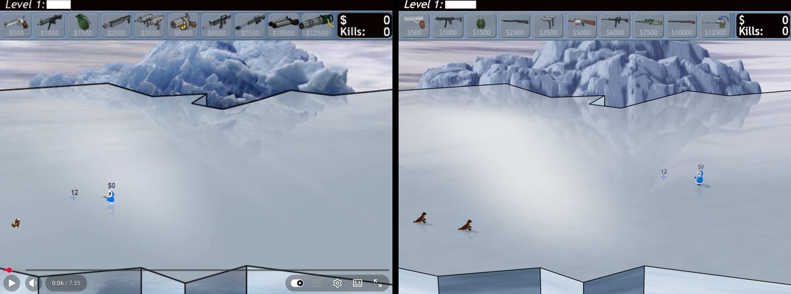 |
| 2 | End of level 2 | 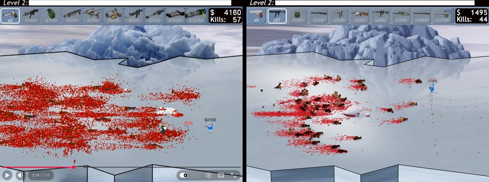 |
| 3 | Middle of level 4 | 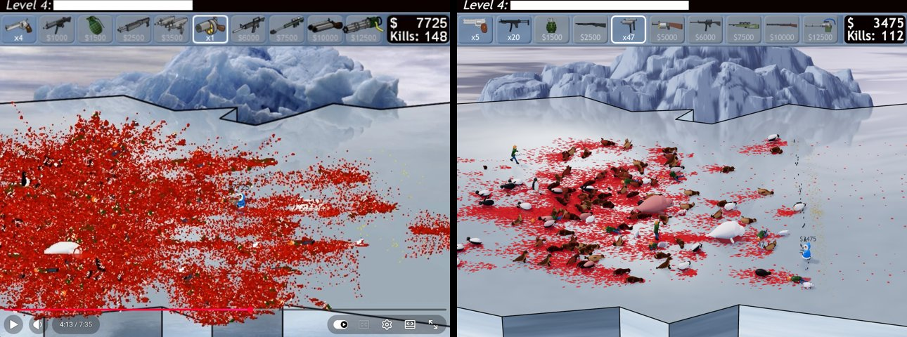 |
| 4 | Level 5 | 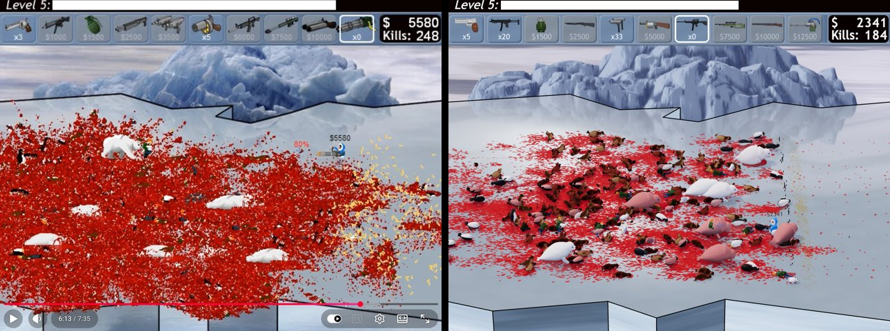 |
| 5 | Walrus boss | 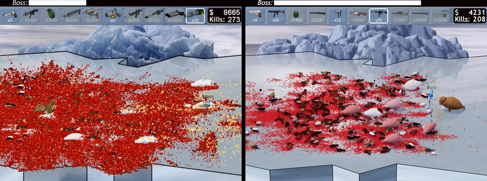 |

What matches:

* 4:3 framing, fixed near-orthographic view, black level/boss strip, steel-blue
  weapon bar with captions, black money/kills box.
* Iceberg silhouette and placement, back-edge outline with the notch, misty
  reflective ice with the iceberg's reflection, front cliff faces.
* Hunter size, colours and position; crosshair with ammo / reload %, money
  above the hunter.
* Accumulating corpses of every creature type, lane-shaped blood fields,
  casings fanning out to the right of the hunter.
* Pacing: the bot's kills over time track the reference player's
  (e.g. 56 kills at 2:09 vs 57 at 2:16; 237 at 6:03 vs 248 at 6:13 in earlier runs).

Remaining differences:

* The original's blood is denser and is drawn *over* the corpses, so late
  frames are almost solid red. Here blood paints the ice and tints corpses as it
  lands on them; coverage is lower and corpses stay more readable.
* The reference player fires the minigun in frames 4–5, giving a much larger
  fan of gold casings; the bot in these captures uses the M4.

## Bosses and ending

| | |
|---|---|
| Fat seal (level 1) 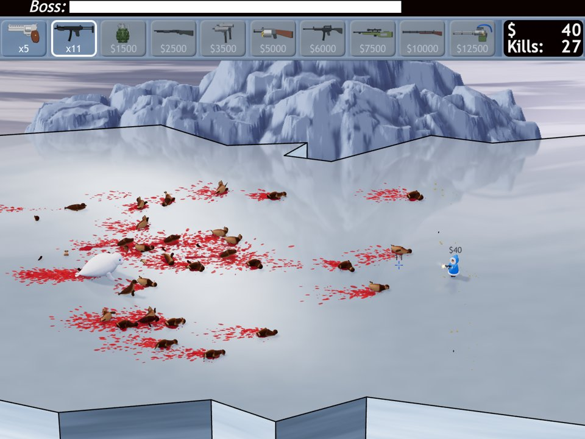 | Penguin wave (level 2) 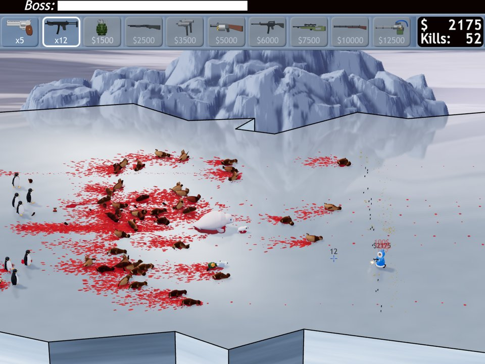 |
| Polar bear (level 3) 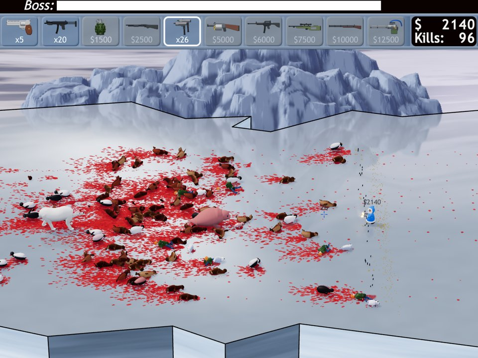 | Turtle (level 4) 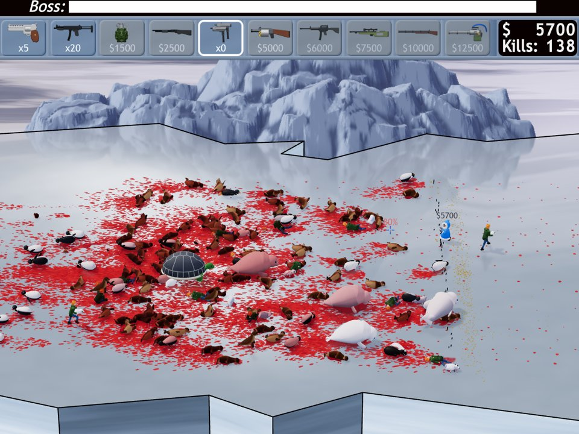 |
| Last seal on the planet 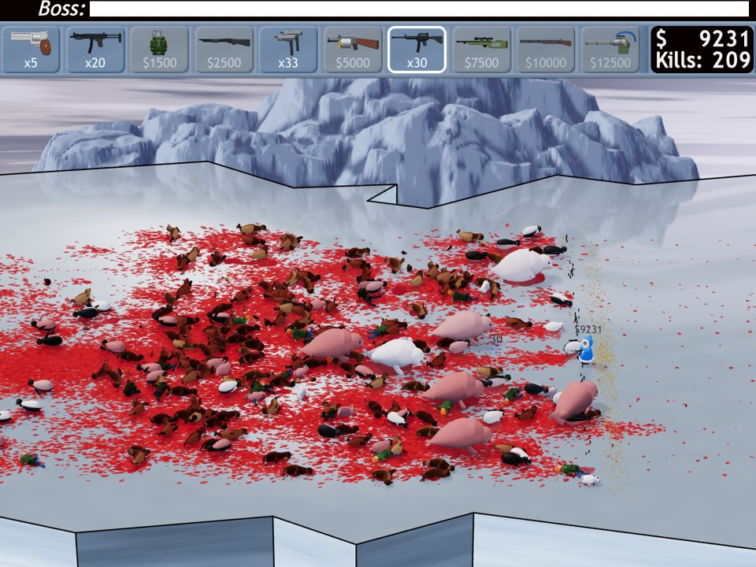 | Final frame at victory 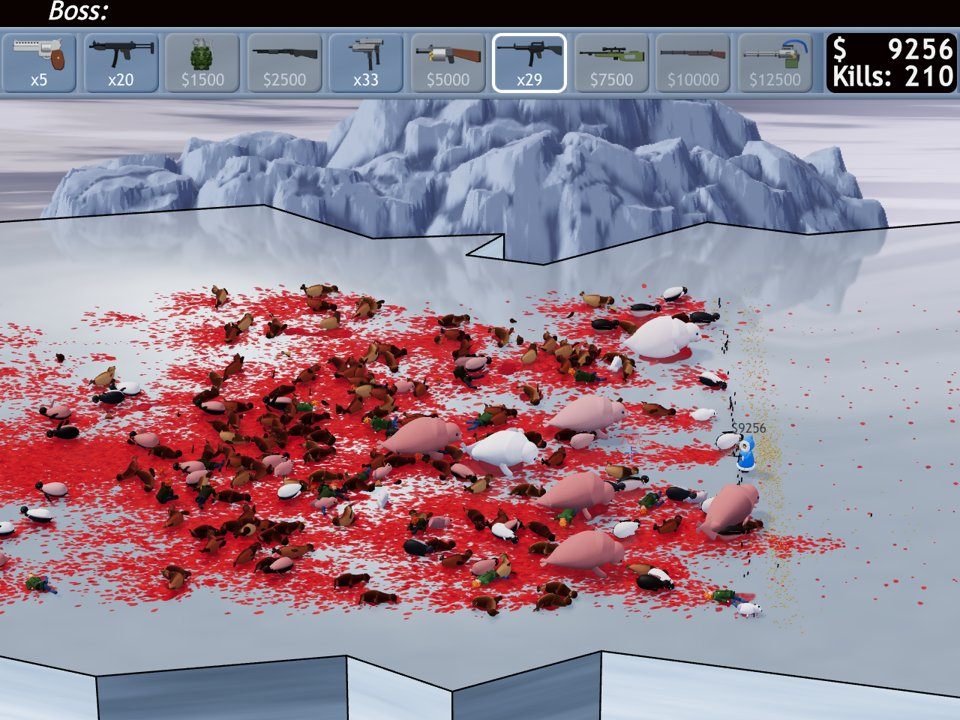 |

## Automated checks

* `npm test` — 26 unit tests: weapon cadence (pistol 13-tick shots / 100-tick
  reload, minigun spin-up to 3 ticks), buy rules, recoil, view-consistent hit
  band and headshots, pierce, turtle ricochet, escapes → game over, activist cub
  shot out / dropped, bear enrage, fat-seal regeneration, level-1 spawn table
  and boss timing, every level's bosses, walrus lane lock and bite, explosion
  damage and bounty, audio mapping vs. the sound files, a 70 s bot game.
* `tools/sim.ts` — headless balance runs with the bot (reaches levels 3–4 with
  the default buy list at skill 1.0; the original's economy and enemy numbers
  are unchanged).
* `tools/fullrun.mjs` — complete game to the victory screen with no page errors
  (7:10 game time, 210 kills, 248 corpses on the ice at the end).
* `tools/weapons.mjs` — every weapon fired at a line of targets (muzzle flash,
  tracers, pellets, explosions, gibs).
* `tools/e2e.mjs` — production build (`npm run build && npm run preview`) loads
  all assets (193 sounds, fonts) and plays without errors.

## Performance

* CPU time per frame for logic + physics + particles + animation, measured in the
  browser during an autoplayed game: 0.07–2.1 ms (levels 1–4, up to 157 corpses).
* Draw calls: ~100–600 depending on the number of live creatures; settled
  corpses are baked into one `BatchedMesh` per material, so hundreds of bodies
  cost a handful of draw calls.
* GPU frame time could not be measured here (software rendering only).
  `?quality=low` drops the planar character reflection and shadows and caps
  the pixel ratio.

## First person, modern UI, denser blood (second round)

* `npm test` — 44 unit tests, including 18 for first person: aimed body/head/miss,
  side and behind shots, pierce, shell ricochet, spread growth with distance,
  aimed grenades and launcher rounds, heading-relative recoil, kicks and movement,
  a first-person aimbot level, and classic-mode regression snapshots.
* Classic mode is unchanged: a bot-driven fingerprint of 5 seeded games (every
  bullet path, hit, projectile and final state) hashes identically before and after
  the first-person logic; classic frames are pixel-identical after switching to
  first person and back (environment and stage); the classic HUD style matches the
  earlier captures.
* The single-file build (`release/SealHunter.html`) was driven from `file://` in a
  headless browser: title → "Play first person" → pointer lock → mouse look, `W`,
  mouse fire → `V` back to classic, all 193 sounds loaded, no page errors.

## Bot teammates and laser sight (third round)

* `npm test` — 51 unit tests. 7 of them are new:
  - up to three named bots, with a single-player world unchanged;
  - the original co-op spawn scaling (n + 0.85 n per extra hunter) and the wider
    lane band (rows 180–420);
  - two bears and two turtles as bosses;
  - three bots holding level 1 on their own while greeting and keeping their sides;
  - the laser line stopping at the first creature in the lane (agreeing with the
    bot's line target), running to the far edge when the lane is empty, and stopping
    at a turtle's shell.
* Single-player classic logic is unchanged: the seeded bot fingerprint still hashes
  `d7df759c`.
* Screenshots in both views and both HUD styles cover:
  - three teammates, with their parkas, crosshairs, money and names;
  - speech balloons kept on screen;
  - the team list and radar dots;
  - spectating after the human dies;
  - the red laser with its dot on a seal;
  - the new rows on both Options screens.
